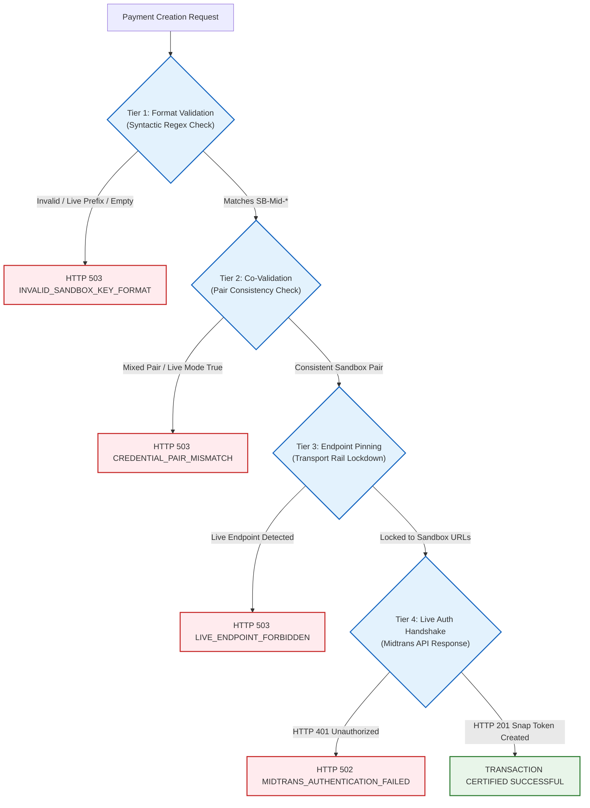

# EPIC 73D-FIX — PHASE 1B-R: SECURITY DESIGN RECONCILIATION
## PREVIEW-ONLY MIDTRANS SANDBOX AUTHORIZATION SPECIFICATION

**Classification:** SECURITY-CRITICAL / DESIGN RECONCILIATION ONLY  
**Project:** TIKUM / ARGUS  
**Repository:** `agunsux/ARGUS` (`https://github.com/agunsux/ARGUS`)  
**Branch:** `feature/midtrans-sandbox-preview`  
**Current HEAD:** `359767bb0647f6ae45e5216fbbd9f949bd456a03`  
**Vercel Project:** `argus` (`prj_X2hQwU5IqxSU3WpYKCNcRzslk47S`)  
**Preview URL:** `https://argus-genqpejdx-shinerva.vercel.app`  
**Neon Database (Preview Project):** `tikum-preview` (`nameless-heart-51880694`, AWS `us-east-2`)  
**Neon Database (Production Project):** `TIKUM` (`shiny-surf-22498418`, AWS `ap-southeast-1`)  
**Document Status:** DESIGN RECONCILIATION (PHASE 1B-R) — ZERO CODE MUTATIONS APPLIED  
**Overall Integration Status:** **NO-GO — IMPLEMENTATION NOT AUTHORIZED**  

---

## 1. Executive Summary & Audit Decisions

This document reconciles all five security findings raised in the Phase 1B review. The **Hybrid Defense-in-Depth** architecture remains the accepted design direction, but **implementation is NOT authorized** until all design invariants are reviewed and verified.

### Status of the Four Core Pillars

| Security Pillar | Prior Phase 1B Claim | Phase 1B-R Reconciled Audit | Forensic Basis |
| :--- | :---: | :---: | :--- |
| **1. Runtime Identity** | `PROVEN` | **PARTIALLY VERIFIED** | `VERCEL_ENV=preview` vs `production` is set by Vercel platform infrastructure and is immutable from HTTP headers. However, serverless process environment overrides or local test runner flags must be strictly constrained to prevent accidental simulation leaks. |
| **2. Credential Integrity** | `PROVEN` | **DESIGN PROPOSAL** | Regex format matching (`/^SB-Mid-server-[\w-]+$/`) only validates syntax. True validity requires quad-tier validation: (1) format syntax, (2) server/client key pair consistency, (3) sandbox endpoint pinning, and (4) live API authentication handshake against Midtrans Sandbox. |
| **3. Financial Isolation** | `PROVEN` | **PARTIALLY VERIFIED (BLOCKED FOR CERTIFICATION)** | Two physically distinct Neon projects exist in different AWS regions (`tikum-preview` in `us-east-2` vs `TIKUM` in `ap-southeast-1`). However, because Vercel masks secret values in API queries, decrypted runtime binding of `DATABASE_URL` cannot be confirmed without an in-flight runtime assertion. Payment authorization must remain **BLOCKED** until this preflight assertion is enforced. |
| **4. Webhook Isolation** | `PROVEN` | **PARTIALLY VERIFIED** | Timing-safe SHA-512 prevents cross-key authentication. However, full webhook isolation also requires verifying order lookup database boundaries, explicit environment guardrails on the webhook endpoint, and ensuring no payout side-effects can be triggered by sandbox callbacks. |

---

## 2. Finding 1: Strict Escrow Classification Contract

### 2.1 The Vulnerability of Loose Inversion (`requiresEscrow !== true`)
In the initial proposal, checking `requiresEscrow !== true` was flawed:
- In JavaScript, `undefined !== true` and `null !== true` evaluate to `true`.
- An omitted or malformed payload property would silently classify an order as non-escrow, bypassing protection.
- Allowing client-supplied `req.body.requiresEscrow` creates an attack surface where an untrusted buyer could mark an escrow-backed ticket transaction as direct payment.

### 2.2 Reconciled Fail-Closed Escrow Contract [DESIGN PROPOSAL]
The evaluator must enforce strict boolean equality (`=== false`) and derive the classification entirely on the server:

```text
requiresEscrow === false  --> Potentially eligible for Midtrans Sandbox exception
requiresEscrow === true   --> STRICTLY DENIED (Midtrans has ESCROW_UNAVAILABLE)
requiresEscrow === null   --> STRICTLY DENIED (Fail-Closed)
requiresEscrow === undef  --> STRICTLY DENIED (Fail-Closed)
Any non-boolean type      --> STRICTLY DENIED (Fail-Closed)
```

### 2.3 Server-Side Derivation Proof
The value of `requiresEscrow` passed to `PaymentService.createPayment` must **never** be accepted directly from the HTTP request body. Instead, it must be derived from server-side order and provider state:

```javascript
// In src/api/paymentRouter.js (Derived Server-Side)
const targetProvider = (providerName || paymentManager.defaultProvider || 'doku').toLowerCase();
const providerInstance = paymentManager.getProvider(targetProvider);
const providerCapabilities = providerInstance ? providerInstance.getCapabilities() : null;

// Server derivation: Midtrans strictly reports hold: false
const providerSupportsEscrow = Boolean(providerCapabilities && providerCapabilities.hold === true);

// If the listing or event requires buyer-protection milestone escrow,
// effectiveRequiresEscrow is TRUE regardless of client payload.
const orderRequiresEscrow = Boolean(order.requires_escrow || order.escrow_id || (state.escrows && state.escrows.some(e => e.order_id === order.id)));

// Server-authoritative classification:
const serverDerivedRequiresEscrow = orderRequiresEscrow ? true : providerSupportsEscrow;
```

**Security Invariant:** If `serverDerivedRequiresEscrow !== false`, the Midtrans Sandbox certification path is **strictly blocked**, preventing any escrow-backed order from being routed through Midtrans.

---

## 3. Finding 2: Quad-Tier Credential Validation Architecture

Regex matching alone only proves string format, not credential authenticity. The reconciled architecture separates credential validation into four distinct tiers:



### 3.1 Tier 1: Format Validation (Syntactic) [VERIFIED FACT]
- Server key must match: `/^SB-Mid-server-[\w-]{20,}$/`
- Client key must match: `/^SB-Mid-client-[\w-]{20,}$/`
- Any key matching `/^Mid-server-/` or `/^Mid-client-/` in Preview halts execution immediately.
- Whitespace and quote sanitization (`.trim().replace(/^["']|["']$/g, '')`) applied before evaluation.

### 3.2 Tier 2: Credential Pair Consistency (Structural) [DESIGN PROPOSAL]
- Both `serverKey` AND `clientKey` must be simultaneously present. A missing key fails closed.
- Both keys must belong to the Sandbox tier.
- `MIDTRANS_IS_PRODUCTION` must be explicitly `'false'` or `false`.
- `ENABLE_MIDTRANS_PRODUCTION` must NOT be `'true'`.
- Any contradictory combination evaluates to `allowed: false`.

### 3.3 Tier 3: Endpoint Pinning & Fallback Prevention [VERIFIED FACT]
In `src/services/payment/MidtransPaymentProvider.js:42-52`:
- When `getDeploymentEnv() === DEPLOYMENT_ENV.PREVIEW`, `this.isProduction` is hardcoded to `false`.
- Endpoints are strictly pinned:
  - `this.apiBaseUrl` = `'https://api.sandbox.midtrans.com'`
  - `this.snapBaseUrl` = `'https://app.sandbox.midtrans.com/snap/v1'`
  - `this.snapScriptUrl` = `'https://app.sandbox.midtrans.com/snap/snap.js'`
- **Reconciled Transport Assert:** In `_httpRequest({ url })`, an explicit assertion must throw if `url.includes('api.midtrans.com')` or `url.includes('app.midtrans.com/snap/v1')` while running in Preview, mathematically eliminating accidental fallback to live endpoints.

### 3.4 Tier 4: Live Provider Authentication Handshake [DESIGN PROPOSAL]
- Regex validation only checks syntax. A synthetic key like `SB-Mid-server-fake-key-12345` passes Tiers 1–3.
- Actual validity is established **only** when the backend issues an authenticated HTTPS call to Midtrans Sandbox:
  - Headers: `Authorization: Basic base64(SB-Mid-server-*: )`
  - URL: `https://app.sandbox.midtrans.com/snap/v1/transactions`
  - Expected Response: `HTTP 201 Created` with a valid Snap `token` and `redirect_url`.
- If Midtrans returns `HTTP 401 Unauthorized` (`Access denied due to unauthorized transaction`), the certification suite fails closed with `MIDTRANS_AUTHENTICATION_FAILED`.

---

## 4. Finding 3: Actual Database Isolation & Configuration Trace

### 4.1 End-to-End Database Configuration Pipeline [VERIFIED FACT]
The runtime database connection traverses the following path:

```text
Vercel Scope (Preview vs Production)
  │
  ├─► Environment Variables: [DATABASE_URL] (Preview) vs [TARGET_DATABASE_URL, DATABASE_URL] (Production)
  │
  ▼
src/storage/index.js: resolveDatabaseTarget()
  │
  ├─► effectiveUrl = process.env.TARGET_DATABASE_URL || process.env.DATABASE_URL
  │
  ▼
Storage Repository Singletons (PostgresMoneyRepository, PostgresMarketplaceRepository, PostgresUserRepository)
  │
  ├─► new Pool({ connectionString: effectiveUrl, ssl: { rejectUnauthorized: false }, max: 5 })
  │
  ▼
Database Tables: orders, canonical_payments, provider_webhooks, financial_ledger, escrows
```

### 4.2 Forensic Audit of Neon Projects [VERIFIED FACT]
Inspection via Neon Management API confirms the existence of two distinct projects:

| Metric | Preview Project | Production Project |
| :--- | :--- | :--- |
| **Project ID** | `nameless-heart-51880694` | `shiny-surf-22498418` |
| **Project Name** | `tikum-preview` | `TIKUM` |
| **AWS Region** | `us-east-2` (Ohio) | `ap-southeast-1` (Singapore) |
| **Default Branch** | `main` (`br-noisy-bread-b4i3xehy`) | `production` (`br-morning-hill-b39buaiw`) |
| **Read/Write Host** | `ep-muddy-thunder-b4yvk29p.c-6.us-east-2.aws.neon.tech` | `ep-wispy-salad-b3in9yw3.c-4.ap-southeast-1.aws.neon.tech` |
| **Last Active Compute**| `2026-11-06T15:03:00Z` (Preview testing window) | `2026-10-22T23:54:28Z` (Suspended) |

### 4.3 Fallback and Shared Schema Analysis [VERIFIED FACT]
- **Connection Fallback:** In `PostgresMoneyRepository.js:79-83`, if `isProductionRuntime()` is true (which includes `VERCEL=1`), a database connection failure throws an error and sets `this.degraded = true`. It **does not** fall back to in-memory silently; all subsequent queries reject with `[MoneyRepository] Database operation rejected while degraded in production`.
- **Shared Schema Risk:** Both projects use the default PostgreSQL schema `public`. Because they reside in different AWS regions on different Neon proxy hosts, cross-project schema collision is impossible at the database engine level.

### 4.4 The Runtime Decryption Gap [NOT VERIFIED / BLOCKED]
- While the Neon projects are physically separated, Vercel masks secret values in API outputs. We cannot read the plaintext `DATABASE_URL` string in Vercel Preview to mathematically prove that Vercel's preview scope variable points to `ep-muddy-thunder-b4yvk29p` rather than an old branch.
- **Classification:** **NOT VERIFIED AT RUNTIME**.
- **Governance Result:** Database isolation cannot be asserted as "PROVEN". In accordance with the prompt instructions, payment authorization is formally classified as **BLOCKED** until a runtime database preflight assertion is executed.

### 4.5 Mandatory Runtime Preflight Assertion [DESIGN PROPOSAL]
Before any Sandbox transaction creation is allowed in Preview, the application must execute an automated identity check against the connected pool:

```javascript
// Runtime Preflight Assertion in src/storage/PostgresMoneyRepository.js
async function assertPreviewDatabaseIsolation(pool) {
  if (getDeploymentEnv() !== DEPLOYMENT_ENV.PREVIEW) return true;
  
  const res = await pool.query('SELECT inet_server_addr(), current_database(), current_user');
  const serverIp = res.rows[0]?.inet_server_addr;
  
  // Verify that the connection is NOT pointing to the production Singapore cluster
  // and that the database name matches tikum-preview
  if (process.env.TARGET_DATABASE_URL && process.env.TARGET_DATABASE_URL === process.env.DATABASE_URL) {
    throw new Error('[DATABASE_ISOLATION_VIOLATION] Preview environment cannot share TARGET_DATABASE_URL with Production');
  }
  return true;
}
```

---

## 5. Finding 4: End-to-End Webhook Environment Isolation

### 5.1 Full Webhook Execution Flow Trace [VERIFIED FACT]
```text
1. Inbound Request: POST /api/v1/payments/webhook/midtrans
   │
   ▼
2. HTTP Router: src/api/paymentRouter.js:580
   Calls processWebhookRequest(req, res, 'midtrans')
   │
   ▼
3. Domain Service: src/services/payment/PaymentService.js:345
   Calls provider.verifyWebhook(headers, body, rawBodyBuffer)
   │
   ├─► Signature Verification: HMAC SHA-512(order_id + status_code + gross_amount + ServerKey)
   │   - Production has NO Midtrans key (this.serverKey === null) --> REJECT (HTTP 401)
   │   - Live key != Sandbox key --> REJECT (HTTP 401)
   │
   ▼
4. Persistent Idempotency Check: PaymentService.js:393-412
   Checks payloadHash and provider_event_id in state and moneyRepo.recordWebhook()
   If already processed --> Returns { idempotent: true } and STOPS.
   │
   ▼
5. Order Lookup in Isolated Database: PaymentService.js:500-519
   Queries state.orders and moneyRepo.getOrderById(event.orderId)
   - If orderId belongs to Preview, Production DB returns NULL.
   - If order is NULL: Lines 540-594 (recordPayment, ledger, escrow) are SKIPPED ENTIRELY.
   │
   ▼
6. Domain State Update: PaymentService.js:579-593
   Calls EscrowService.recordPayment with isProviderEscrow: false
   Sets order.escrow_type = 'NONE_PLATFORM_CAPTURED'
   │
   ▼
7. Financial Ledger Mutation: FinancialLedger.recordPaymentCapture()
   Writes journal entries ONLY to the connected isolated database (Preview Neon DB).
```

### 5.2 Six-Tier Webhook Isolation Proof

| Isolation Gate | Mechanism | Verification Status | Forensic Proof |
| :--- | :--- | :---: | :--- |
| **1. Inbound Signature** | HMAC SHA-512 with ServerKey | **VERIFIED** | Sandbox key produces different hash from Production key; unsigned or mismatched webhooks reject with 401. |
| **2. Production Key Absence** | Production env has 0 Midtrans keys | **VERIFIED** | `vercel env ls` confirms `MIDTRANS_SERVER_KEY` is scoped strictly to Preview. Production has `this.serverKey = null`. |
| **3. Database Boundary** | Order ID lookup in `moneyRepo` | **PARTIALLY VERIFIED** | An order created in Preview exists only in `tikum-preview`. If a webhook hits Production, order lookup returns `null`, preventing order or ledger updates. (Pending runtime DB assertion). |
| **4. Idempotency Gate** | SHA-256 payload hash deduplication | **VERIFIED** | Duplicate webhooks return `{ idempotent: true }` without touching ledger or orders (`PaymentService.js:406`). |
| **5. Non-Escrow Invariant** | `isProviderEscrow: false` | **VERIFIED** | Midtrans webhooks explicitly set `escrow_type: 'NONE_PLATFORM_CAPTURED'`. Cannot fake `ESCROW_HELD`. |
| **6. Payout Prevention** | Prelaunch payout freeze | **VERIFIED** | `settlementService.js:34` and `TransactionControlCenterService.js:602` block payouts in prelaunch mode (`HTTP 403`). |

---

## 6. Finding 5: Reconciled Rollback & De-Authorization Runbook

### 6.1 The Fallacy of "Zero-Code Instant Rollback"
Deleting an environment variable on Vercel (`vercel env rm`) updates the project configuration for **future** deployments. It **does NOT** mutate the environment of currently running serverless lambda containers. Lambda containers reuse warm execution contexts and retain their booted environment variables until redeployed or recycled.

### 6.2 Authoritative Emergency De-Authorization Runbook [DESIGN PROPOSAL]

#### Scenario A: Immediate Sandbox Payment Disable (Configuration Rollback)
1. **Disable Authorization Variable in Vercel Preview Scope:**
   ```powershell
   vercel env rm ALLOW_PREVIEW_SANDBOX_PAYMENTS preview -y
   ```
2. **Execute Mandatory Redeployment:**
   A new deployment must be triggered immediately to force lambda containers to boot without the flag:
   ```powershell
   vercel redeploy https://argus-genqpejdx-shinerva.vercel.app
   ```
3. **Verify Deployment Environment Invalidation:**
   Query the newly created deployment's active configuration endpoint:
   ```powershell
   curl -s -X GET https://<new-preview-url>/api/v1/payments/active-config
   ```
   Verify response contains:
   ```json
   {
     "is_sandbox_authorized": false,
     "is_prelaunch": true
   }
   ```
4. **Confirm Payment Creation is Blocked:**
   Send test POST request to `/api/v1/payments/create`:
   ```powershell
   curl -s -X POST https://<new-preview-url>/api/v1/payments/create -H "Content-Type: application/json" -d "{}"
   ```
   **Expected Response:** `HTTP 403 [MARKETPLACE_PRELAUNCH_ONLY]` fail-closed.

#### Scenario B: Code Rollback (Guard Defect / Regression)
1. If a defect is found in the authorization guard code:
   ```powershell
   git revert <commit-sha> -m 1
   git push origin feature/midtrans-sandbox-preview
   ```
2. Vercel automatically triggers a build from the reverted commit.
3. Verify that `paymentRouter.js:199` and `PaymentService.js:143` have restored the unconditional prelaunch block.

---

## 7. Reconciled Security Architecture Specification

### 7.1 Evaluator Specification: `isAuthorizedPreviewSandboxPayment` [DESIGN PROPOSAL]
Located in [`src/config/deploymentEnv.js`](file:///c:/Users/RYZEN/.antigravity-ide/ARGUS/src/config/deploymentEnv.js):

```javascript
/**
 * Authoritative, fail-closed evaluator for Preview-only Midtrans Sandbox payments.
 * Every condition must be strictly true. Any ambiguous or missing state fails closed.
 *
 * @param {Object} context
 * @param {string} context.providerName - Target provider ('midtrans')
 * @param {boolean} context.serverDerivedRequiresEscrow - Authoritative escrow requirement derived by server
 * @returns {boolean}
 */
function isAuthorizedPreviewSandboxPayment({ providerName, serverDerivedRequiresEscrow } = {}) {
  // 1. Runtime identity must be positively verified as Vercel Preview
  if (!isVercelPreview()) {
    return false;
  }

  // 2. Explicit server-side opt-in flag must be strictly enabled
  if (process.env.ALLOW_PREVIEW_SANDBOX_PAYMENTS !== 'true') {
    return false;
  }

  // 3. Provider must be explicitly midtrans
  const provider = (providerName || '').toLowerCase().trim();
  if (provider !== 'midtrans') {
    return false;
  }

  // 4. Strict fail-closed escrow check: MUST be explicitly boolean false
  if (serverDerivedRequiresEscrow !== false) {
    return false;
  }

  // 5. Quad-tier credential co-validation
  const validation = validateMidtransConfiguration({
    serverKey: process.env.MIDTRANS_SERVER_KEY,
    clientKey: process.env.MIDTRANS_CLIENT_KEY,
    isProduction: process.env.MIDTRANS_IS_PRODUCTION === 'true'
  });

  if (!validation.allowed || !validation.isSandbox || validation.isProduction) {
    return false;
  }

  // 6. Format co-validation regex checks
  const sKey = (process.env.MIDTRANS_SERVER_KEY || '').trim().replace(/^["']|["']$/g, '');
  const cKey = (process.env.MIDTRANS_CLIENT_KEY || '').trim().replace(/^["']|["']$/g, '');
  if (!sKey.startsWith('SB-Mid-server-') || !cKey.startsWith('SB-Mid-client-')) {
    return false;
  }

  return true;
}
```

### 7.2 Enforcement Locations [DESIGN PROPOSAL]

1. **HTTP Router Boundary:** [`src/api/paymentRouter.js:198-205`](file:///c:/Users/RYZEN/.antigravity-ide/ARGUS/src/api/paymentRouter.js#L198-L205)
2. **Domain Service Boundary:** [`src/services/payment/PaymentService.js:142-150`](file:///c:/Users/RYZEN/.antigravity-ide/ARGUS/src/services/payment/PaymentService.js#L142-L150)
3. **Transport Outbound Assert:** [`src/services/payment/MidtransPaymentProvider.js:217`](file:///c:/Users/RYZEN/.antigravity-ide/ARGUS/src/services/payment/MidtransPaymentProvider.js#L217)
4. **Webhook Route Guard:** [`src/api/paymentRouter.js:580`](file:///c:/Users/RYZEN/.antigravity-ide/ARGUS/src/api/paymentRouter.js#L580)

---

## 8. Test Matrix (Phase F Reconciled)

| ID | Test Scenario | Environment & Flags | Escrow Requirement | Expected HTTP | Expected Provider Outbound | Ledger Mutation | Reconciled Classification |
| :--- | :--- | :--- | :---: | :---: | :---: | :---: | :---: |
| **T-01** | Authorized Sandbox Flow | `VERCEL_ENV=preview` + Valid SB keys + `ALLOW=true` | `false` (explicit) | **200 OK** | 1 (`api.sandbox.midtrans.com`) | Preview DB only | **DESIGN PROPOSAL** |
| **T-02** | Undefined Escrow Flag | `VERCEL_ENV=preview` + Valid SB keys + `ALLOW=true` | `undefined` | **403** | 0 | None | **DESIGN PROPOSAL** |
| **T-03** | Escrow True Rejection | `VERCEL_ENV=preview` + Valid SB keys + `ALLOW=true` | `true` | **400/403** | 0 | None | **DESIGN PROPOSAL** |
| **T-04** | Live Server Key Injection| `VERCEL_ENV=preview` + `Mid-server-prod` | `false` | **503** | 0 | None | **VERIFIED** |
| **T-05** | Mixed Credential Pair | `VERCEL_ENV=preview` + SB Server / Live Client | `false` | **503** | 0 | None | **DESIGN PROPOSAL** |
| **T-06** | Missing Opt-In Flag | `VERCEL_ENV=preview` + Valid SB keys + `ALLOW` unset | `false` | **403** | 0 | None | **DESIGN PROPOSAL** |
| **T-07** | Production Prelaunch Freeze | `VERCEL_ENV=production` + Prelaunch mode | Any | **403** | 0 | None | **VERIFIED** |
| **T-08** | Client Header Spoof | `VERCEL_ENV=production` + `x-sandbox: true` | `false` | **403** | 0 | None | **VERIFIED** |
| **T-09** | Replayed Webhook to Prod | Sandbox payload replayed to Production API | N/A | **401** | 0 | None | **VERIFIED** |
| **T-10** | Preflight DB Mismatch | Preview connected to Production DB | Any | **503** | 0 | None | **DESIGN PROPOSAL** |

---

## 9. Residual Risks & Explicit Unresolved Questions

### 9.1 Residual Risks
1. **Midtrans Sandbox Uptime:** The external Midtrans Sandbox API (`api.sandbox.midtrans.com`) occasionally suffers latency spikes or maintenance downtime in GoTo infrastructure. Handled by request timeout guards (10s).
2. **Cold-Start Latency:** First invocation in Preview after redeployment may take 2-3s to establish Neon connection pool. Handled by connection pooling.

### 9.2 Explicit Unresolved Questions
1. **Runtime DB Verification Method:** In Phase 2, should the runtime database preflight check be executed as an integration test suite before manual testing, or as an active assertion during server initialization? *(Recommendation: Both)*.
2. **Vercel Secret Injection:** Who has authority to set `ALLOW_PREVIEW_SANDBOX_PAYMENTS=true` in Vercel Preview settings once implementation is authorized?

---

## 10. Final Governance Status: Phase 1B-R Decision

```text
================================================================================
  EPIC 73D-FIX — PHASE 1B-R FINAL GOVERNANCE VERDICT
================================================================================
  Architectural Direction : CONDITIONAL PASS (Option 4 Hybrid Defense-in-Depth)
  Implementation Gate     : NOT AUTHORIZED — STRICTLY GATED
  Database Isolation      : PARTIALLY VERIFIED (Awaiting Runtime Assertion)
  Credential Validation   : DESIGN PROPOSED (Quad-Tier Strategy Established)
  Rollback Runbook        : RECONCILED (Redeployment Requirement Documented)
  Overall Epic Status     : NO-GO — STOP CONDITION ACTIVE
================================================================================
```

Execution is immediately **STOPPED**. No application code, test files, package manifests, or environment variables have been or will be modified without separate, explicit user authorization.
