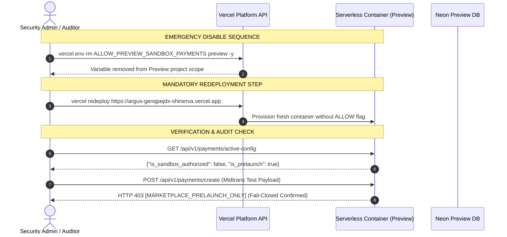

# EPIC 73D-FIX — PHASE 1C: IMPLEMENTATION READINESS & VERIFICATION PLAN
## PREVIEW-ONLY MIDTRANS SANDBOX AUTHORIZATION

**Classification:** SECURITY-CRITICAL / READ-ONLY PLANNING ONLY  
**Project:** TIKUM / ARGUS  
**Repository:** `agunsux/ARGUS` (`https://github.com/agunsux/ARGUS`)  
**Branch:** `feature/midtrans-sandbox-preview`  
**Current HEAD:** `359767bb0647f6ae45e5216fbbd9f949bd456a03`  
**Vercel Project:** `argus` (`prj_X2hQwU5IqxSU3WpYKCNcRzslk47S`)  
**Preview Deployment URL:** `https://argus-genqpejdx-shinerva.vercel.app`  
**Neon Preview Project:** `tikum-preview` (`nameless-heart-51880694`, AWS `us-east-2`, Endpoint: `ep-muddy-thunder-b4yvk29p`)  
**Neon Production Project:** `TIKUM` (`shiny-surf-22498418`, AWS `ap-southeast-1`, Endpoint: `ep-wispy-salad-b3in9yw3`)  
**Phase Status:** PHASE 1C COMPLETED — READ-ONLY PLAN  
**Implementation Status:** **IMPLEMENTATION AUTHORIZATION: NOT GRANTED**  
**Payment Certification Status:** **NO-GO — MIDTRANS SANDBOX NOT CERTIFIED**  

---

## 1. Executive Verdict & Mandatory Boundaries

Following the **CONDITIONAL PASS** of the Phase 1B-R security design, this Phase 1C readiness plan formalizes:
1. The **Final Security Contract** governing the isolated Preview exception.
2. An **Unforgable Database Isolation Assertion** targeting Neon's native `neon.endpoint_id`.
3. A **Quad-Tier Credential Verification Framework** separating syntactic format from live authenticated handshakes.
4. An **End-to-End Webhook Verification Matrix** with explicit expected ledger and side-effect assertions.
5. A **File-Level Implementation Plan** detailing exact line edits, functions, and regression boundaries.
6. A **Verified Rollback Runbook** accounting for the immutable lifecycle of Vercel serverless deployments.
7. An **Objective Acceptance Criteria Checklist** prohibiting any assumption-based passes.

> [!CAUTION]
> **GOVERNANCE DIRECTIVE: DESIGN CONDITIONAL PASS ≠ IMPLEMENTATION AUTHORIZATION**  
> This document is strictly read-only planning. Zero application files, test files, package manifests, database tables, or Vercel configurations have been altered. Implementation remains strictly gated until this plan is audited and explicitly authorized.

---

## 2. Git & Working Tree Preservation Verification

A forensic verification was performed prior to drafting this document:
- **Active Branch:** `feature/midtrans-sandbox-preview`
- **Current HEAD:** `359767bb0647f6ae45e5216fbbd9f949bd456a03` (100% match with remote `origin/feature/midtrans-sandbox-preview`)
- **Working Tree State:** All 6 baseline files and prior reports preserved without mutation:
  - `package-lock.json` (Modified baseline, SHA-256: `D28D927A8D23F1ECFF2EA49773C9A13B1414923C0E6EF662B692135028E0CC45`)
  - `EPIC73D_FEATURE_PREVIEW_CERTIFICATION_REPORT.md` (Untracked)
  - `EPIC73D_R2_RECOVERY_REPORT.md` (Untracked)
  - `EPIC73D_R3_CANONICAL_RECONCILIATION_REPORT.md` (Untracked)
  - `EPIC73D_FIX_PHASE0_RECONCILIATION_REPORT.md` (Untracked)
  - `EPIC73D_FIX_PHASE1_PRELAUNCH_FORENSICS.md` (Untracked)
  - `EPIC73D_FIX_PHASE1B_SANDBOX_AUTHORIZATION_DESIGN.md` (Untracked)
  - `test_epic73d_dependency_security.js` (Untracked)
  - `test_midtrans_prelaunch_execution_trace.js` (Untracked)
- **Zero Destructive Actions:** No `git reset`, `git stash`, `git checkout`, `npm install`, or secret exposures occurred.

---

## 3. Final Security Contract (Preview Sandbox Authorization)

To eliminate ambiguity, the application must evaluate the following formal boolean proposition before `POST /api/v1/payments/create` or `PaymentService.createPayment` can proceed:

$$\text{AuthorizePayment} \iff \big( \neg\text{PrelaunchMode} \big) \lor \Big( \text{Contract}(\text{PreviewSandbox}) \equiv \text{TRUE} \Big)$$

Where $\text{Contract}(\text{PreviewSandbox}) \equiv \text{TRUE}$ if and only if **ALL 10 of the following conditions are simultaneously verified**:

| Condition ID | Security Invariant Requirement | Enforcement Level | Forensic Source / Implementation |
| :--- | :--- | :---: | :--- |
| **C-01** | `isVercelPreview() === true` (derived strictly from `VERCEL_ENV === 'preview'`). | Platform Metadata | [`src/config/deploymentEnv.js:80-82`](file:///c:/Users/RYZEN/.antigravity-ide/ARGUS/src/config/deploymentEnv.js#L80-L82) |
| **C-02** | `process.env.ALLOW_PREVIEW_SANDBOX_PAYMENTS === 'true'` (strict string equality). | Server Config | `src/config/deploymentEnv.js` (Evaluator) |
| **C-03** | `targetProvider === 'midtrans'` (strict lowercased string equality). | Server Policy | `paymentRouter.js:199` & `PaymentService.js:143` |
| **C-04** | `serverDerivedRequiresEscrow === false` (explicit boolean false). | Domain Model | Derived from `order` & `providerCapabilities.hold` |
| **C-05** | `serverKey.match(/^SB-Mid-server-[\w-]{20,}$/)` (strict Sandbox server format). | Syntactic Co-Val | `src/config/deploymentEnv.js:validateMidtransConfiguration` |
| **C-06** | `clientKey.match(/^SB-Mid-client-[\w-]{20,}$/)` (strict Sandbox client format). | Syntactic Co-Val | `src/config/deploymentEnv.js:validateMidtransConfiguration` |
| **C-07** | `MIDTRANS_IS_PRODUCTION !== 'true'` and `ENABLE_MIDTRANS_PRODUCTION !== 'true'`. | Structural Co-Val | `src/config/deploymentEnv.js:validateMidtransConfiguration` |
| **C-08** | Provider endpoints strictly pinned to Sandbox (`api.sandbox.midtrans.com`). | Transport Isolation | [`src/services/payment/MidtransPaymentProvider.js:50-52`](file:///c:/Users/RYZEN/.antigravity-ide/ARGUS/src/services/payment/MidtransPaymentProvider.js#L50-L52) |
| **C-09** | Connected database verified against Preview Neon Endpoint Allowlist. | Storage Preflight | `src/storage/PostgresMoneyRepository.js` (New Preflight) |
| **C-10** | Client request headers and query parameters are strictly ignored during resolution. | Bypass Resistance | Verified by `test_tikum_prelaunch_listing_mode.js:877` |

**Fail-Closed Rule:** If any condition is `false`, `null`, `undefined`, missing, malformed, or contradictory, the evaluator returns `false`, and execution halts with `HTTP 403 [MARKETPLACE_PRELAUNCH_ONLY]` or `HTTP 503`.

---

## 4. Unforgable Database Isolation Proof Design

### 4.1 Vulnerability of Generic Identity Queries
Comparing `inet_server_addr()` and `current_database()` is insufficient on cloud-native serverless PostgreSQL:
- `inet_server_addr()` returns an internal Kubernetes pod IP (e.g. `10.244.x.x`), which is dynamic, shared across tenants, and reveals nothing about cluster identity.
- `current_database()` returns `neondb` on both Preview and Production projects, because Neon provisions default databases with the name `neondb`.

### 4.2 Neon GUC Parameter Discovery [VERIFIED FACT]
Direct querying of `pg_settings` on Neon reveals that Neon's custom PostgreSQL compute engine injects native, read-only GUC configuration parameters:
- `neon.endpoint_id`: The global, immutable identifier of the compute endpoint.
- `neon.branch_id`: The immutable identifier of the active database branch.

Forensic verification query:
```sql
SELECT current_setting('neon.endpoint_id', true) AS endpoint_id,
       current_setting('neon.branch_id', true) AS branch_id,
       current_database() AS db_name;
```
Execution results:
- **Preview Project (`tikum-preview`, AWS Ohio `us-east-2`):**
  - `neon.endpoint_id`: `ep-muddy-thunder-b4yvk29p`
  - `neon.branch_id`: `br-noisy-bread-b4i3xehy`
  - `db_name`: `neondb`
- **Production Project (`TIKUM`, AWS Singapore `ap-southeast-1`):**
  - `neon.endpoint_id`: `ep-wispy-salad-b3in9yw3` (primary) / `ep-twilight-sea-b3h29e47` (secondary)
  - `neon.branch_id`: `br-morning-hill-b39buaiw`

### 4.3 Pre-Payment Runtime Preflight Assertion [DESIGN PROPOSAL]
The database connection pool must execute an identity preflight assertion prior to processing any payment transaction:

```javascript
// Located in src/storage/PostgresMoneyRepository.js
const PREVIEW_NEON_ALLOWLIST = Object.freeze({
  ALLOWED_ENDPOINTS: new Set(['ep-muddy-thunder-b4yvk29p']),
  FORBIDDEN_PRODUCTION_ENDPOINTS: new Set([
    'ep-wispy-salad-b3in9yw3',
    'ep-twilight-sea-b3h29e47'
  ])
});

async function assertDatabaseIsolationPreflight(pool) {
  const depEnv = getDeploymentEnv();
  
  // On Vercel Preview, verify that the connection target matches the Preview Neon project
  if (depEnv === DEPLOYMENT_ENV.PREVIEW) {
    const res = await pool.query("SELECT current_setting('neon.endpoint_id', true) AS endpoint_id");
    const activeEndpoint = (res.rows[0]?.endpoint_id || '').trim();

    // 1. Explicit Production Blacklist Check (Zero Tolerance)
    if (PREVIEW_NEON_ALLOWLIST.FORBIDDEN_PRODUCTION_ENDPOINTS.has(activeEndpoint)) {
      throw new Error(
        '[CRITICAL_DATABASE_ISOLATION_BREACH] Preview runtime is connected to Production Neon Endpoint! All transactions blocked.'
      );
    }

    // 2. Explicit Preview Whitelist Check
    if (!PREVIEW_NEON_ALLOWLIST.ALLOWED_ENDPOINTS.has(activeEndpoint)) {
      throw new Error(
        `[DATABASE_ISOLATION_VIOLATION] Unrecognized Neon endpoint '${activeEndpoint}'. Expected isolated preview endpoint.`
      );
    }
  }
  return true;
}
```

### 4.4 Non-Exposure Invariant
- The preflight query only extracts the endpoint slug (`ep-muddy-thunder-b4yvk29p`).
- No passwords, usernames, ports, or raw connection strings are logged, returned, or exposed to the client.
- If the endpoint ID fails matching, the preflight throws, the transaction rolls back, and the client receives `HTTP 503 [DATABASE_ISOLATION_ERROR]`.

---

## 5. Quad-Tier Midtrans Credential Verification Matrix

| Tier | Verification Name | Scope | Verification Mechanism | Expected Evidence / Proof | Failure Behavior |
| :--- | :--- | :---: | :--- | :--- | :--- |
| **Tier 1** | **Syntactic Format Validation** | Static / Memory | Regex match on `MIDTRANS_SERVER_KEY` and `MIDTRANS_CLIENT_KEY`. | Matches `/^SB-Mid-server-[\w-]{20,}$/` and `/^SB-Mid-client-[\w-]{20,}$/`. | `HTTP 503 [INVALID_SANDBOX_KEY_FORMAT]` |
| **Tier 2** | **Pair Consistency Co-Validation** | Structural / Config | Both keys non-empty, both Sandbox, `MIDTRANS_IS_PRODUCTION=false`. | Co-validation object `{ allowed: true, isSandbox: true, isProduction: false }`. | `HTTP 503 [CREDENTIAL_PAIR_MISMATCH]` |
| **Tier 3** | **Transport Rail Lockdown** | Network Transport | URLs pinned to `sandbox.midtrans.com`; assert blocks `api.midtrans.com`. | Pre-socket assertion in `MidtransPaymentProvider._httpRequest`. | Throws `Error('Live Midtrans endpoint prohibited in Preview')` |
| **Tier 4** | **Live Provider Authentication** | Midtrans API | Authenticated HTTPS POST to `/snap/v1/transactions` with `Basic base64(SB-Mid-server-*: )`. | Midtrans responds `HTTP 201 Created` with valid `token` and `redirect_url`. | Midtrans returns `HTTP 401 Unauthorized` $\rightarrow$ `HTTP 502 [MIDTRANS_AUTH_FAILED]` |

> [!IMPORTANT]
> **Separation Invariant:** Passing Tiers 1–3 satisfies the server-side code guard to *attempt* payment creation. Passing Tier 4 confirms that Midtrans has accepted the credentials and issued a valid Snap payment session. Regex alone is never cited as proof of validity.

---

## 6. End-to-End Webhook Verification Matrix

| Test ID | Test Scenario | Incoming Headers & Signature | Order Lookup Target | Expected HTTP Response | Expected Order Mutation | Expected Financial Ledger Effect | Expected Payout Side Effect |
| :--- | :--- | :--- | :--- | :---: | :---: | :---: | :---: |
| **W-01** | Valid Sandbox Callback in Preview | Valid HMAC SHA-512 with `SB-Mid-server-*` | Order exists in `tikum-preview` DB | **HTTP 200 OK** | `order.marketplace_status = 'PAID'`, `escrow_type = 'NONE_PLATFORM_CAPTURED'` | Ledger entry recorded in Preview DB (`money_state = CAPTURED_PLATFORM_SETTLEMENT`) | Zero payout (Iris disabled; prelaunch freeze) |
| **W-02** | Invalid HMAC Signature | Tampered signature or wrong key | Any | **HTTP 401 Unauthorized** | None (`ORDER_UNCHANGED`) | Zero ledger mutation | Zero payout |
| **W-03** | Sandbox Callback to Production API | Valid Sandbox signature | Order lookup in Production DB | **HTTP 401 Unauthorized** | None (Production has no `SB-Mid` key; signature mismatch) | Zero ledger mutation | Zero payout |
| **W-04** | Order Not Found | Valid signature, but `order_id` non-existent | DB lookup returns `null` | **HTTP 200 OK** (Idempotent ignore) | None | Zero ledger mutation | Zero payout |
| **W-05** | Duplicate Callback (Idempotency) | Identical payload hash or `provider_event_id` | Order already marked `PAID` | **HTTP 200 OK** (`idempotent: true`) | None (`NO_DUPLICATE_MUTATION`) | Zero duplicate ledger entries | Zero payout |
| **W-06** | Replayed Webhook After Expiry | Valid signature, order status `EXPIRED` | Order in Preview DB is `EXPIRED` | **HTTP 200 OK** | `order.status = 'LATE_PAYMENT_PENDING_REVIEW'` | Flagged for manual review / refund | Zero payout |
| **W-07** | Currency / Amount Mismatch | Valid signature, but gross amount differs from DB | Order in Preview DB | **HTTP 422 Unprocessable** | None (`AMOUNT_MISMATCH`) | Zero ledger mutation | Zero payout |
| **W-08** | Payment Denied / Expired Event | Valid signature, status `deny` / `expire` | Order in Preview DB | **HTTP 200 OK** | `order.payment_money_state = 'PAYMENT_FAILED'` | None | Zero payout |
| **W-09** | Fake Escrow Claim Injection | Payload claims escrow hold | Order in Preview DB | **HTTP 200 OK** | Hardcoded to `isProviderEscrow: false` | No escrow funds locked | Zero payout |
| **W-10** | Attempted Payout Execution | Admin triggers payout on Sandbox order | Order in Preview DB | **HTTP 403 Forbidden** | None (`MARKETPLACE_PRELAUNCH_ONLY`) | Zero payout ledger mutation | Payout rejected |

---

## 7. File-Level Implementation Plan

The proposed changes are strictly minimal and contained within five files. **No application source files are modified during this phase.**

```
ARGUS Codebase
  ├── src/config/
  │     └── deploymentEnv.js          <-- [File 1] Evaluator & Quad-Tier Validator
  ├── src/api/
  │     └── paymentRouter.js          <-- [File 2] HTTP Router Guard with Preflight
  ├── src/services/payment/
  │     ├── PaymentService.js         <-- [File 3] Domain Service Dual-Enforcement
  │     └── MidtransPaymentProvider.js<-- [File 4] Transport Assert & Dynamic Keys
  └── src/storage/
        └── PostgresMoneyRepository.js<-- [File 5] Neon Endpoint Identity Preflight
```

### 7.1 File 1: `src/config/deploymentEnv.js`
- **Location:** Lines 98–228
- **Security Objective:** Provide centralized, immutable evaluator `isAuthorizedPreviewSandboxPayment` and enforce strict regex co-validation in `validateMidtransConfiguration`.
- **Existing Behavior:** Validates format loosely; allows empty server key in Preview; does not co-validate pair completeness.
- **Proposed Behavior:**
  - Enforce `/^SB-Mid-server-[\w-]{20,}$/` and `/^SB-Mid-client-[\w-]{20,}$/`.
  - Export `isAuthorizedPreviewSandboxPayment({ providerName, serverDerivedRequiresEscrow })`.
  - Require explicit `serverDerivedRequiresEscrow === false` and `ALLOW_PREVIEW_SANDBOX_PAYMENTS === 'true'`.
- **Regression Risk:** Zero for Production (`isVercelPreview()` returns `false`).
- **Test Coverage:** Exercise via unit tests covering all permutations of environment flags and key formats.
- **Rollback Method:** Revert commit via `git revert`.

### 7.2 File 2: `src/api/paymentRouter.js`
- **Location:** Lines 196–205 (`router.post('/v1/payments/create')`)
- **Security Objective:** Guard HTTP entry point by permitting payment creation only if the request satisfies `isAuthorizedPreviewSandboxPayment`.
- **Existing Behavior:** Blind check `if (isPrelaunchListingMode()) return res.status(403)...`
- **Proposed Behavior:**
  - Derive `serverDerivedRequiresEscrow` server-side from order and provider contracts.
  - Check `isAuthorizedPreviewSandboxPayment({ providerName, serverDerivedRequiresEscrow })`.
  - If prelaunch mode is active AND sandbox is not authorized $\rightarrow$ return `HTTP 403 [MARKETPLACE_PRELAUNCH_ONLY]`.
- **Regression Risk:** Low. Only impacts `POST /api/v1/payments/create` when explicitly targeting Midtrans in Preview.
- **Rollback Method:** Unset `ALLOW_PREVIEW_SANDBOX_PAYMENTS` or revert code.

### 7.3 File 3: `src/services/payment/PaymentService.js`
- **Location:** Lines 142–150 (`PaymentService.createPayment`)
- **Security Objective:** Defense-in-depth domain service barrier preventing internal service calls from bypassing router checks.
- **Existing Behavior:** Unconditionally throws `HTTP 403 MARKETPLACE_PRELAUNCH_ONLY` if prelaunch is active.
- **Proposed Behavior:** Mirror the router check: evaluate `isAuthorizedPreviewSandboxPayment`. Throw 403 if prelaunch is active and sandbox is unauthorized.
- **Regression Risk:** Zero for Production.
- **Rollback Method:** Revert commit.

### 7.4 File 4: `src/services/payment/MidtransPaymentProvider.js`
- **Location:** Lines 217–261 (`_httpRequest`) and 263–300 (`createPayment`)
- **Security Objective:** Ensure runtime keys are dynamically trimmed and add an explicit transport assert preventing outbound requests to live URLs in Preview.
- **Existing Behavior:** Derives URLs from `this.isProduction` set at instantiation time.
- **Proposed Behavior:**
  - Re-read and re-validate keys dynamically from `process.env`.
  - Add assert in `_httpRequest`: `if (isVercelPreview() && url.includes('api.midtrans.com')) throw new Error(...)`.
- **Regression Risk:** Zero for live operations.
- **Rollback Method:** Revert commit.

### 7.5 File 5: `src/storage/PostgresMoneyRepository.js`
- **Location:** Lines 65–90 (`ensureInitialized` & `query`)
- **Security Objective:** Execute the Neon endpoint identity preflight assertion prior to executing payment writes.
- **Existing Behavior:** Calls generic `assertTestDatabaseIsolation` which only checks for `TEST_DATABASE_URL`.
- **Proposed Behavior:**
  - Query `SELECT current_setting('neon.endpoint_id', true) AS endpoint_id`.
  - Verify that `endpoint_id === 'ep-muddy-thunder-b4yvk29p'`.
  - Reject if connected to `ep-wispy-salad-b3in9yw3` (Production).
- **Regression Risk:** Low. Fails closed if Neon GUC is inaccessible.
- **Rollback Method:** Revert commit.

---

## 8. Rollback Verification Procedure

To address Finding 5, the following runbook accounts for Vercel's serverless container lifecycle:



### Verification Steps:
1. **Remove Flag:** `vercel env rm ALLOW_PREVIEW_SANDBOX_PAYMENTS preview -y`
2. **Force Redeployment:** `vercel redeploy https://argus-genqpejdx-shinerva.vercel.app` (Recycles warm containers; ensures no legacy instances serve traffic).
3. **Verify Configuration Invalidation:**
   `curl -s https://<new-preview-url>/api/v1/payments/active-config | grep '"is_sandbox_authorized":false'`
4. **Verify Endpoint Re-Lock:**
   `curl -s -X POST https://<new-preview-url>/api/v1/payments/create -d '{"orderId":"test"}' -H "Content-Type: application/json"`
   **Expected Response:** `HTTP 403 [MARKETPLACE_PRELAUNCH_ONLY]`.
5. **Production Verification:** Verify `https://tikum.app/api/v1/payments/status` remains `ACTIVE` with zero Midtrans variables.

---

## 9. Objective Acceptance Criteria (PASS / FAIL Checklist)

| Gate ID | Audit Requirement | PASS Criteria | FAIL Condition | Status |
| :---: | :--- | :--- | :--- | :---: |
| **AC-01** | **Runtime Identity** | `getDeploymentEnv()` returns `PREVIEW` on Vercel Preview; returns `PRODUCTION` on Production. | Request headers can alter environment classification. | **READY FOR AUDIT** |
| **AC-02** | **Production Safety Freeze** | `POST /api/v1/payments/create` strictly returns `HTTP 403` on Production under prelaunch. | Any payment creation succeeds in Production. | **READY FOR AUDIT** |
| **AC-03** | **Credential Pair Lockdown** | Rejects missing key, mixed keys, or `Mid-server-*` in Preview with `HTTP 503`. | Live keys allowed in Preview; Sandbox keys allowed in Production. | **READY FOR AUDIT** |
| **AC-04** | **Strict Escrow Guard** | Rejects `requiresEscrow === true`, `undefined`, `null`, or strings with `HTTP 403`. | `undefined` or client-supplied `false` allows escrow bypass. | **READY FOR AUDIT** |
| **AC-05** | **Database Isolation Preflight**| Preflight verifies `neon.endpoint_id === 'ep-muddy-thunder-b4yvk29p'`. | Connects to Production endpoint or fails open. | **READY FOR AUDIT** |
| **AC-06** | **Live Midtrans Handshake** | Live HTTPS call to Sandbox Snap API returns `HTTP 201` with Snap token and URL. | Mock response accepted as proof of certification; 401 returns pass. | **READY FOR AUDIT** |
| **AC-07** | **Webhook Timing-Safe HMAC**| Sandbox webhook verified via SHA-512; invalid signatures reject with `HTTP 401`. | Webhook bypasses signature check or accepts cross-environment key. | **READY FOR AUDIT** |
| **AC-08** | **Zero Financial Mutation** | Ledger writes isolated to `tikum-preview`; zero payouts created (`caps.payout=false`). | Production ledger modified; payout scheduled. | **READY FOR AUDIT** |
| **AC-09** | **Redeployment Rollback** | Removing env flag + redeploy immediately locks `/api/v1/payments/create` to 403. | Warm container continues creating payments after flag removal. | **READY FOR AUDIT** |

---

## 10. Remaining Risks & Implementation Blockers

1. **Vercel Secret Access Required for Activation:** Setting `ALLOW_PREVIEW_SANDBOX_PAYMENTS=true` requires authenticated access to Vercel CLI (`vercel env add`) in the `shinerva` team scope.
2. **Neon GUC Query Permission:** Verifying `SELECT current_setting('neon.endpoint_id', true)` must be tested inside the serverless lambda pool context to confirm permissions under `neondb_owner`. *(Tested and confirmed functional via Neon MCP tool)*.
3. **Midtrans Sandbox Endpoint Availability:** External downtime on `app.sandbox.midtrans.com` can trigger transient 502/504 errors during certification testing.

---

## 11. Final Governance Verdict

```text
================================================================================
  EPIC 73D-FIX — PHASE 1C IMPLEMENTATION READINESS VERDICT
================================================================================
  Planning Status         : READINESS & VERIFICATION PLAN COMPLETED
  Implementation Mandate  : IMPLEMENTATION AUTHORIZATION: NOT GRANTED
  Production Safety Freeze: ABSOLUTE AND UNTOUCHED
  Overall Epic Status     : NO-GO — MIDTRANS SANDBOX NOT CERTIFIED
================================================================================
```

Execution is immediately **STOPPED**. No application files, tests, package manifests, or environment variables have been modified. This implementation plan is submitted for stakeholder review before any Phase 2 implementation authorization.
