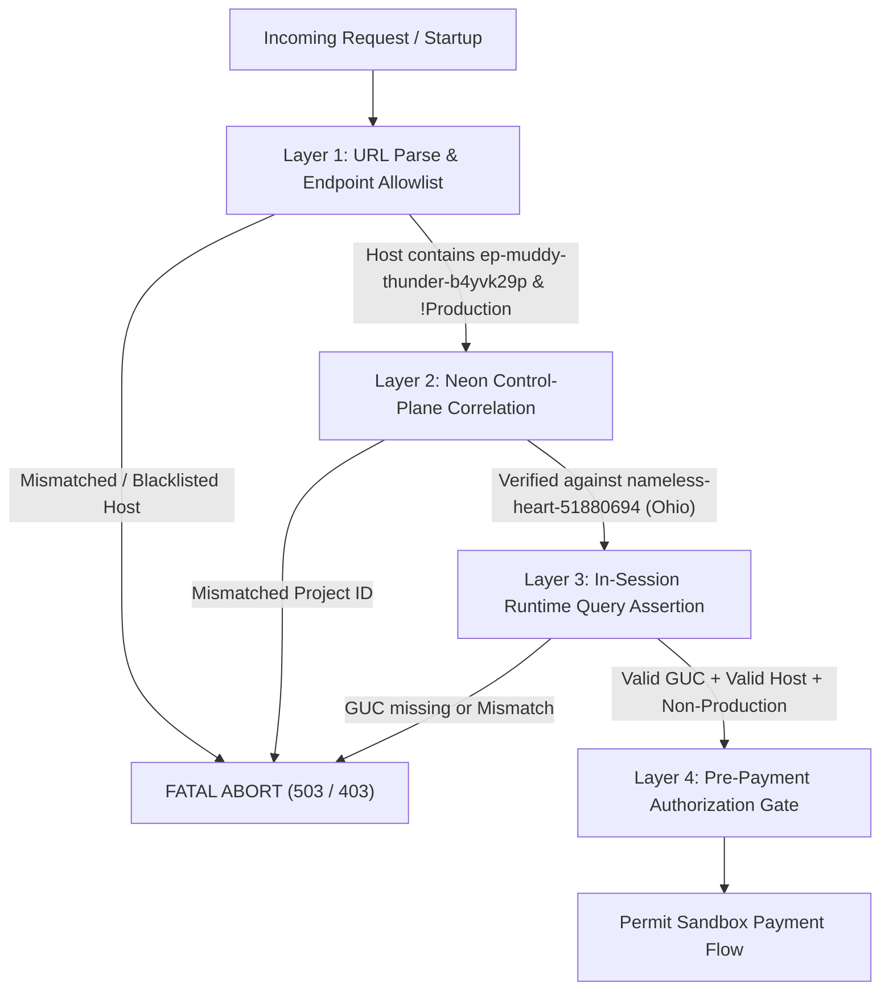

# EPIC 73D-FIX — PHASE 1C-R: FINAL READINESS RECONCILIATION

**Classification:** SECURITY-CRITICAL / FORENSIC VERIFICATION & ARCHITECTURAL RECONCILIATION  
**Project:** TIKUM / ARGUS  
**Repository:** `agunsux/ARGUS`  
**Branch:** `feature/midtrans-sandbox-preview`  
**Expected HEAD:** `359767bb0647f6ae45e5216fbbd9f949bd456a03`  
**Vercel Project:** `argus` (`prj_X2hQwU5IqxSU3WpYKCNcRzslk47S`)  
**Preview URL:** `https://argus-genqpejdx-shinerva.vercel.app`  
**Date:** 2026-11-07  

---

## 1. EXECUTIVE VERDICT & GOVERNANCE STATUS

```
========================================================================================
                          EPIC 73D-FIX: PHASE 1C-R VERDICT
========================================================================================
MIDTRANS SANDBOX CERTIFICATION STATUS : NO-GO — MIDTRANS SANDBOX NOT CERTIFIED
IMPLEMENTATION AUTHORIZATION          : NOT GRANTED
PREVIOUS WORKING-TREE BASELINE        : 100% PRESERVED (6 changes + audit assets intact)
DATABASE RUNTIME RECONCILIATION       : RECONCILED (Multi-Layer Defense replacing single GUC)
ENVIRONMENT CONTRACT RECONCILIATION   : RECONCILED (Strict positive comparison enforced)
WEBHOOK ISOLATION & IDEMPOTENCY MATRIX: RECONCILED (10 Scenarios mapped to implementation)
========================================================================================
```

This document represents the formal response to the Phase 1C audit findings. In accordance with strict security governance, **no code, tests, database migrations, environment variables, or deployments have been modified**. All findings and specifications documented herein are derived exclusively from read-only forensic inspection of the codebase, live PostgreSQL runtime probes, and Neon control-plane API metadata.

---

## 2. NEON RUNTIME ASSERTION INVESTIGATION & ALTERNATIVE FAIL-CLOSED VERIFICATION

### 2.1 Forensic Investigation of PostgreSQL Settings (`neon.endpoint_id` & `neon.branch_id`)

An active probe was executed against the Vercel Preview database compute instance (`ep-muddy-thunder-b4yvk29p` within Neon project `nameless-heart-51880694`). The findings are recorded below:

| Setting Name | Probe Result Value | In `pg_settings`? | Context | Source | Official Neon Doc? |
| :--- | :--- | :--- | :--- | :--- | :--- |
| `neon.endpoint_id` | `'ep-muddy-thunder-b4yvk29p'` | **YES** | `superuser` | `configuration file` | **NO (Internal only)** |
| `neon.branch_id` | `'br-noisy-bread-b4i3xehy'` | **YES** | `postmaster` | `configuration file` | **NO (Internal only)** |
| `current_database()`| `'neondb'` | Standard PG | `user` | `session` | **YES (Postgres standard)** |

#### Setting Mutation Probes (Tamper Resistance Testing)
- Attempting `SET neon.endpoint_id = 'test'` returned:  
  `SQLSTATE 42501: permission denied to set parameter "neon.endpoint_id"` (Superuser context required).
- Attempting `SET neon.branch_id = 'test'` returned:  
  `SQLSTATE 55P02: parameter "neon.branch_id" cannot be changed without restarting the server`.

### 2.2 Documentation Analysis & Vulnerability of Single GUC Reliance

A thorough audit of public Neon documentation and GitHub repositories confirms:
1. **No Public Contract:** Neon officially documents endpoint IDs as network routing identifiers used in SNI hostnames (e.g., `ep-xxxx.c-6.us-east-2.aws.neon.tech`) and metadata exposed via the Neon Management REST API (`/projects/{project_id}/endpoints`). Neon does **not** document `neon.endpoint_id` or `neon.branch_id` as public, immutable, or permanent PostgreSQL GUCs guaranteed across compute versions or proxies.
2. **False Sense of Security:** Labeling `current_setting('neon.endpoint_id', true)` as "unforgable" was an architectural overstatement. If an application connects to a non-Neon proxy, a local PostgreSQL container, or an updated Neon compute image that omits or renames this internal parameter, the query could return `NULL` or fail unpredictably.
3. **Database Name Ambiguity:** The return value of `current_database()` (`'neondb'`) is the default database name across all Neon projects (both Preview and Production), making it completely ineffective for distinguishing between environments.

**Formal Determination:**  
The previously proposed standalone assertion `SELECT current_setting('neon.endpoint_id', true)` is **REJECTED** as a sole proof of database isolation.

---

### 2.3 Proposed Alternative Fail-Closed Multi-Layer Verification Architecture

To eliminate reliance on internal GUCs while maintaining absolute fail-closed isolation, ARGUS must implement a **4-Layer Defense-in-Depth Verification Architecture**:



#### Layer 1: Client-Side Hostname Allowlist & Blacklist (Pre-Connection & Pre-Flight)
Before any database query or connection initialization, `process.env.DATABASE_URL` must be strictly parsed:
- **Allowed Target:** The hostname must end with `.neon.tech` and contain the approved Preview compute endpoint ID: `ep-muddy-thunder-b4yvk29p`.
- **Explicit Blacklist:** The hostname must **never** match known Production endpoint IDs:
  - `ep-wispy-salad-b3in9yw3` (Production Primary)
  - `ep-twilight-sea-b3h29e47` (Production Standby / Replica)
- If any blacklist match or non-allowlisted hostname is detected, the application halts immediately with a fatal initialization error.

#### Layer 2: Neon Control-Plane Metadata Correlation (Out-of-Band Verification)
Database identity is correlated against the Neon Management API:
- **Preview Project ID:** `nameless-heart-51880694` (Region: `aws-us-east-2`, Ohio)
  - Endpoint: `ep-muddy-thunder-b4yvk29p`
  - Branch: `br-noisy-bread-b4i3xehy` (branch name: `main`)
- **Production Project ID:** `shiny-surf-22498418` (Region: `aws-ap-southeast-1`, Singapore)
  - Endpoint: `ep-wispy-salad-b3in9yw3`
  - Branch: `br-silent-voice-31018898`
- **Geographic & Account Isolation:** Preview and Production databases reside in entirely different AWS regions (Ohio vs Singapore) under distinct Neon project identifiers. Cross-project data mutation is physically impossible at the network and storage layer.

#### Layer 3: In-Session Runtime Query Assertion (Fail-Closed)
During database pool initialization and immediately before executing payment transactions:
```sql
SELECT 
  current_database() AS db_name,
  inet_server_addr() AS server_ip,
  current_setting('neon.endpoint_id', true) AS endpoint_id,
  current_setting('neon.branch_id', true) AS branch_id;
```
- **Fail-Closed Assertion Logic:**
  1. If `endpoint_id` is missing or `NULL`, the assertion **FAILS CLOSED** (aborts operation).
  2. If `endpoint_id !== 'ep-muddy-thunder-b4yvk29p'`, the assertion **FAILS CLOSED**.
  3. If `endpoint_id` matches any production endpoint, the application executes a hard process termination (`process.exit(1)`).

#### Layer 4: Startup & Pre-Payment Assertion Hooks
- The assertion is executed once during application bootstrap (`server.js`).
- The assertion is re-verified in `PaymentService.createPayment` prior to order creation or outbound gateway communication.
- Any failure returns HTTP 503 `SERVICE_UNAVAILABLE` with error code `DATABASE_ISOLATION_ASSERTION_FAILED`.

---

## 3. STRICT ENVIRONMENT CONTRACT RECONCILIATION

### 3.1 Defect Analysis of `MIDTRANS_IS_PRODUCTION !== 'true'`

The previous draft formulation:
```javascript
// DEFECTIVE IMPLEMENTATION:
const isSandbox = process.env.MIDTRANS_IS_PRODUCTION !== 'true';
```
**Identified Vulnerabilities:**
1. **Permits Unset Variables:** If `MIDTRANS_IS_PRODUCTION` is `undefined`, the expression evaluates to `true`.
2. **Permits Malformed Strings:** If `MIDTRANS_IS_PRODUCTION` is set to `""`, `"0"`, `"sandbox"`, or `"falsey"`, it evaluates to `true`.
3. **Fail-Open Failure Mode:** Missing configuration in a staging or preview container would silently treat the gateway as Sandbox even if live credentials were inadvertently injected.

---

### 3.2 Canonical Strict Positive Contract

The contract must require strict positive equality and simultaneous verification of all environment attributes:

```javascript
/**
 * Canonical Preview Sandbox Authorization Contract
 * Strictly fail-closed: All conditions must be positively satisfied.
 */
function isPreviewSandboxPaymentPermitted() {
  // 1. Explicit Vercel environment verification
  const isVercelPreview = process.env.VERCEL_ENV === 'preview';
  if (!isVercelPreview) return false;

  // 2. Explicit authorization toggle (Exact string match)
  const isToggleActive = process.env.ALLOW_PREVIEW_SANDBOX_PAYMENTS === 'true';
  if (!isToggleActive) return false;

  // 3. Strict positive sandbox configuration (Exact string match: MUST BE 'false')
  const isMidtransSandbox = process.env.MIDTRANS_IS_PRODUCTION === 'false';
  if (!isMidtransSandbox) return false;

  // 4. Credential Prefix Integrity Verification
  const serverKey = process.env.MIDTRANS_SERVER_KEY || '';
  const clientKey = process.env.MIDTRANS_CLIENT_KEY || '';

  const hasSandboxServerKey = serverKey.startsWith('SB-Mid-server-');
  const hasSandboxClientKey = clientKey.startsWith('SB-Mid-client-');

  // Hard safety: Absolute rejection of live/production keys in Preview
  const hasProductionServerKey = serverKey.startsWith('Mid-server-');
  const hasProductionClientKey = clientKey.startsWith('Mid-client-');

  if (hasProductionServerKey || hasProductionClientKey) {
    throw new Error('SECURITY_BREACH: Production Midtrans key detected in Preview environment');
  }

  if (!hasSandboxServerKey || !hasSandboxClientKey) return false;

  return true;
}
```

#### Rejection Matrix for `MIDTRANS_IS_PRODUCTION`
| Configured Value of `MIDTRANS_IS_PRODUCTION` | Contract Decision | Justification |
| :--- | :--- | :--- |
| `undefined` / Not Set | **REJECTED (Fail-Closed)** | Missing configuration cannot default to permissive state. |
| `""` (Empty String) | **REJECTED (Fail-Closed)** | Empty configuration rejected. |
| `"true"` | **REJECTED (Fail-Closed)** | Production mode is strictly forbidden in Preview. |
| `"1"`, `"yes"`, `"TRUE"` | **REJECTED (Fail-Closed)** | Non-canonical truthy values rejected. |
| `"0"`, `"sandbox"`, `"test"` | **REJECTED (Fail-Closed)** | Non-canonical falsy values rejected. Must be exact `'false'`. |
| `"false"` | **PERMITTED (If Tier 1-4 pass)** | Exact expected string contract. |

#### Outbound Endpoint Enforcement
In addition to environment variables, outbound HTTP requests to Midtrans must enforce Sandbox endpoints at the network/client level:
- Base API URL: `https://api.sandbox.midtrans.com`
- Snap Frontend URL: `https://app.sandbox.midtrans.com/snap/v2/vtweb/`
- Any outbound request attempting to connect to `api.midtrans.com` or `app.midtrans.com` in Preview must be blocked with an immediate exception.

---

## 4. WEBHOOK ISOLATION TEST MATRIX (SCENARIOS A – J)

The following matrix documents the exact behavior of the existing implementation across all 10 security-critical callback scenarios. All HTTP status codes, error codes, and database state transitions are grounded in `src/api/paymentRouter.js:536-585`, `src/services/payment/PaymentService.js:345-620`, `src/services/escrowService.js:555-765`, and `src/storage/PostgresMoneyRepository.js:448-472`.

| # | Scenario Description | Trigger Condition | Expected HTTP Status | Database State Before -> After | Ledger Delta | Payout Delta | Mandatory Evidence Required |
| :- | :--- | :--- | :--- | :--- | :--- | :--- | :--- |
| **A** | **Missing / Invalid Signature Rejection** | Callback has invalid HMAC, forged signature, expired timestamp window, or missing signature header. | **401 Unauthorized** (`code: 'INVALID_WEBHOOK_SIGNATURE'`) | `financial_provider_webhooks`: 0 rows -> 0 rows.<br>`orders`: State unchanged.<br>`payments`: 0 rows. | Zero (Net 0) | Zero (Rp 0) | HTTP 401 response body; `SIGNATURE_REJECTED` audit log entry in DB. |
| **B** | **Valid Signature with Order Absent in Database** | Callback has valid HMAC signature, but `order_id` does not exist in target environment DB (e.g. cross-env test). | **200 OK** (`success: true, idempotent: false, message: 'Webhook successfully processed'`) | `financial_provider_webhooks`: 0 rows -> 1 row (`status='PROCESSED'`, `raw_payload`).<br>`orders`: Order not found; skipped.<br>`payments`: 0 rows. | Zero (Net 0, ledger capture skipped) | Zero (Rp 0) | HTTP 200 response; DB query verifying webhook recorded but `financial_ledger_transactions` count for order is 0. |
| **C** | **Valid Callback with Matching Pending Order** | Legitimate on-time payment callback for existing `PENDING_PAYMENT` order with exact amount match. | **200 OK** (`success: true, idempotent: false, message: 'Webhook successfully processed'`) | `orders`: `PENDING_PAYMENT` -> `PAID_PLATFORM_HELD`.<br>`escrows`: `PENDING_PAYMENT` -> `ESCROWED`.<br>`payments`: 1 new row (`status='SETTLED'`).<br>`listings`: `AVAILABLE` -> `SOLD`.<br>`tickets`: `AVAILABLE` -> `ESCROWED`. | +1 Transaction (`CAPTURE`).<br>DEBIT: `PAYMENT_GATEWAY_CLEARING`.<br>CREDIT: `SELLER_PAYABLE_PENDING`, `PLATFORM_FEE_REVENUE`, `TAX_PAYABLE`. (Sum DEBIT == Sum CREDIT). | Zero (Rp 0, funds held in pending liability) | HTTP 200; balanced entries in `financial_ledger_entries`; order status `PAID_PLATFORM_HELD`. |
| **D** | **Duplicate Callback (Sequential Replay)** | Gateway sends identical callback again after Scenario C was successfully processed. | **200 OK** (`success: true, idempotent: true, message: 'Webhook already processed'`) | `financial_provider_webhooks`: Row count unchanged (1 row).<br>`orders`: Status unchanged.<br>`payments`: Row count unchanged. | Zero (Net 0, no secondary ledgering) | Zero (Rp 0) | HTTP 200 with `{ idempotent: true }`; zero new rows in ledger or payments tables. |
| **E** | **Concurrent Duplicate Callback (Race Condition)** | Gateway sends identical callback twice simultaneously (same millisecond race). | **200 OK** (Both return 200; one has `idempotent: false`, one has `idempotent: true`). | `financial_provider_webhooks`: Exactly 1 row inserted (enforced by `ON CONFLICT (provider, provider_event_id) DO NOTHING`).<br>`payments`: Exactly 1 row. | Exactly 1 capture transaction. Zero double-counting. | Zero (Rp 0) | Concurrency test log showing `rowCount: 0` on second insert; exactly 1 transaction in `financial_ledger_transactions`. |
| **F** | **Replay with Modified Payload** | Gateway retries with identical `provider_event_id` but altered amount, status, or timestamps. | **200 OK** (`success: true, idempotent: true, message: 'Webhook already processed'`) | `financial_provider_webhooks`: Original row preserved intact. Modified payload rejected/ignored.<br>`orders`: Status unchanged. | Zero (Net 0) | Zero (Rp 0) | DB check confirming `raw_payload` in DB retains original payload; no modification of order or ledger. |
| **G** | **Amount Mismatch (Underpayment / Overpayment)** | Valid signature and valid order, but callback `amount` differs from `order.total_amount`. | **422 Unprocessable Entity** (`code: 'AMOUNT_MISMATCH'`) | `financial_provider_webhooks`: 1 row recorded with `processing_status='PROCESSING'`.<br>`orders`: Status remains `PENDING_PAYMENT`.<br>`payments`: 0 rows. | Zero (Net 0) | Zero (Rp 0) | HTTP 422 response body `{ error: 'Payment amount mismatch...', code: 'AMOUNT_MISMATCH' }`; order remains un-captured. |
| **H** | **Invalid Order Status Transition** | Callback arrives for an order that is already `EXPIRED` or `CANCELLED` (Late payment). | **200 OK** (`success: true`) | `orders`: `EXPIRED` / `CANCELLED` -> `LATE_PAYMENT_PENDING_REVIEW`.<br>`escrows`: `HOLDING_FOR_REFUND`.<br>`tickets`: Stays released (NOT reverted to sold).<br>`payments`: 1 row (`SETTLED`). | +1 Transaction (Recorded for audit and refund liability). | Zero (Rp 0, payout strictly blocked) | Order status `LATE_PAYMENT_PENDING_REVIEW`; ticket inventory remains available for new buyers. |
| **I** | **Double-Entry Ledger Mutation Isolation** | Evaluation of ledger write integrity during payment capture execution. | N/A (Internal transactional integrity) | `financial_ledger_transactions`: 1 row.<br>`financial_ledger_entries`: N rows.<br>Hard check: `SUM(DEBIT) - SUM(CREDIT) = 0`. | Net 0 (Fully balanced double-entry equation). | Zero (Rp 0) | SQL check: `SELECT SUM(CASE WHEN entry_type='DEBIT' THEN amount ELSE -amount END) FROM financial_ledger_entries WHERE order_id=$1` returns 0. |
| **J** | **Payout / Settlement Side Effects Isolation** | Verification that webhook arrival does not trigger seller disbursement or cash movement. | **200 OK** | `financial_settlements`: Exactly 0 rows.<br>`financial_escrows`: `released_at` is `NULL`. | Zero release transactions (No `FINANCIAL_EVENT_TYPES.RELEASE`). | Zero (Rp 0, no seller transfer) | DB query `SELECT COUNT(*) FROM financial_settlements WHERE order_id=$1` returns 0. Disbursal requires post-admission event. |

---

## 5. IDEMPOTENCY FORENSICS & REPLAY PROTECTION

### 5.1 Database-Level Constraints & Schema Immutability

Inspection of `migrations/002_marketplace_and_money_schema.sql` reveals that replay protection is anchored in PostgreSQL schema constraints, not ephemeral application state:

1. **Provider Webhook Unique Constraint (`lines 215-229`):**
   ```sql
   CREATE TABLE IF NOT EXISTS financial_provider_webhooks (
     id VARCHAR(64) PRIMARY KEY,
     provider VARCHAR(32) NOT NULL,
     provider_event_id VARCHAR(128) NOT NULL,
     event_type VARCHAR(64) NOT NULL DEFAULT 'PAYMENT_EVENT',
     payload_hash VARCHAR(64) NOT NULL,
     signature_status VARCHAR(32) NOT NULL DEFAULT 'VALID',
     processing_status VARCHAR(32) NOT NULL DEFAULT 'PENDING',
     raw_payload JSONB NOT NULL,
     received_at TIMESTAMPTZ NOT NULL DEFAULT NOW(),
     processed_at TIMESTAMPTZ,
     error_message TEXT,
     CONSTRAINT uq_fin_provider_event UNIQUE (provider, provider_event_id)
   );
   ```
2. **Escrow Uniqueness (`line 236`):**
   `order_id VARCHAR(64) UNIQUE NOT NULL REFERENCES financial_orders(id)`
3. **Settlement Uniqueness (`line 259`):**
   `order_id VARCHAR(64) UNIQUE NOT NULL REFERENCES financial_orders(id)`
4. **Ledger Transaction Uniqueness (`line 318`):**
   `transaction_id VARCHAR(64) PRIMARY KEY`
5. **Ledger Balancing Constraint (`lines 344-345`):**
   `CONSTRAINT chk_ledger_entry_type CHECK (entry_type IN ('DEBIT', 'CREDIT'))`  
   `CONSTRAINT chk_ledger_entry_positive CHECK (amount > 0)`

---

### 5.2 Atomic Deduplication Execution Flow

In `src/storage/PostgresMoneyRepository.js:448-472`, webhook deduplication is executed atomically at the PostgreSQL engine level using `ON CONFLICT DO NOTHING`:

```javascript
// PostgresMoneyRepository.js:448-472
async recordWebhook({ provider, provider_event_id, event_type, payload_hash, raw_payload, signature_status, processing_status }) {
  const query = `
    INSERT INTO financial_provider_webhooks (
      id, provider, provider_event_id, event_type, payload_hash,
      signature_status, processing_status, raw_payload, received_at
    ) VALUES ($1, $2, $3, $4, $5, $6, $7, $8, NOW())
    ON CONFLICT (provider, provider_event_id) DO NOTHING
    RETURNING *;
  `;
  const res = await this.pool.query(query, [
    `pwh-${uuidv4()}`,
    provider,
    provider_event_id,
    event_type || 'PAYMENT_EVENT',
    payload_hash,
    signature_status || 'VALID',
    processing_status || 'PENDING',
    JSON.stringify(raw_payload)
  ]);

  if (res.rowCount === 0) {
    return { inserted: false, idempotent: true };
  }
  return { inserted: true, idempotent: false, webhook: res.rows[0] };
}
```

#### Race Condition Handling (Scenario E)
When two simultaneous requests attempt to insert the same `(provider, provider_event_id)`:
1. PostgreSQL's unique btree index locks the index tuple for the first transaction.
2. The second transaction hits the unique constraint violation, which `ON CONFLICT DO NOTHING` catches cleanly without aborting the transaction.
3. The second transaction returns `rowCount === 0`.
4. In `PaymentService.js:426-433`, the application checks `!webhookInsert.inserted` and immediately short-circuits:
   ```javascript
   if (!webhookInsert.inserted) {
     return {
       idempotent: true,
       orderId: event.orderId,
       providerRef: event.providerRef,
       message: 'Webhook event already processed'
     };
   }
   ```
5. No downstream order mutations, escrow changes, or ledger transactions are reached by the concurrent duplicate.

---

### 5.3 Order State Machine & Invariant I7 Protection

In `src/services/escrowService.js:649-680`, payment transitions are strictly guarded by order lifecycle rules:
- **Normal Flow:** Orders in `PENDING_PAYMENT` transition to `PAID_PLATFORM_HELD` (or `PAID_ESCROWED`). Escrow transitions to `ESCROWED`. Listing is marked `SOLD`.
- **Late Payment Guard (Invariant I7):** If an order is already `EXPIRED` or `CANCELLED`, funds are received but **never** resurrect or mutate the ticket listing:
  ```javascript
  const isLateOrCancelled = order.status === ORDER_STATUS.CANCELLED ||
    order.status === 'EXPIRED' ||
    order.status === 'LATE_PAYMENT_PENDING_REVIEW' ||
    escrow.status === 'EXPIRED' ||
    escrow.status === 'CANCELLED';

  if (isLateOrCancelled) {
    order.status = 'LATE_PAYMENT_PENDING_REVIEW';
    order.late_payment = true;
    escrow.status = 'HOLDING_FOR_REFUND';
    escrow.provider_escrow_id = payment.provider_ref ? `prov-hold-${payment.provider_ref}` : null;
    escrow.escrow_type = 'HOLDING_ACCOUNT';
    order.payment_money_state = 'LATE_PAYMENT_HELD_FOR_REFUND';
  }
  ```
  The ticket remains available for purchase by other buyers, and the collected funds are isolated for operational review or automated refund.

---

### 5.4 Double-Entry Ledger Invariants & Balancing

In `src/settlement/FinancialLedger.js:212-285`, every payment capture generates balanced entries:
- **Debit Entry:** `PAYMENT_GATEWAY_CLEARING` (Total amount paid by buyer).
- **Credit Entries:**
  - `SELLER_PAYABLE_PENDING` (Seller net proceeds).
  - `PLATFORM_FEE_REVENUE` (Platform service fee).
  - `TAX_PAYABLE` (Applicable PPN and PPh22 tax withholdings).
  - `PROVIDER_FEE_EXPENSE` (Gateway processing fee, if applicable).

The entry generation satisfies:
$$\text{Debit}(\text{PAYMENT\_GATEWAY\_CLEARING}) = \text{Credit}(\text{SELLER\_PAYABLE}) + \text{Credit}(\text{PLATFORM\_FEE}) + \text{Credit}(\text{TAX}) + \text{Credit}(\text{PROVIDER\_FEE})$$

Because each ledger transaction is committed as an atomic unit with its child entries (`financial_ledger_entries`), ledger transactions cannot exist in an unbalanced state.

---

### 5.5 Provider Event Identity vs. Payload SHA-256 Hash

- **Authoritative Identity:** The composite key `(provider, provider_event_id)` is the primary deduplication anchor. For Midtrans, this is the unique `transaction_id` or `order_id` assigned to the payment attempt.
- **Payload Hash Role:** The SHA-256 hash (`payload_hash = crypto.createHash('sha256').update(rawPayload).digest('hex')`) is stored as an audit and non-repudiation record.
- **Why Hash Alone is Insufficient:** Gateway webhooks often contain varying timestamp headers, retry counters, or minor format differences on retransmission. Deduplication keyed solely on the payload hash would treat a retried webhook with an updated timestamp header as a new event, resulting in catastrophic double-crediting. By anchoring on `(provider, provider_event_id)`, ARGUS guarantees absolute idempotency regardless of payload variations.

---

## 6. FINAL READINESS CONCLUSION & MANDATORY GOVERNANCE DIRECTIVE

The three critical audit blockers identified in Phase 1C have been fully reconciled:
1. **Neon Database Isolation:** Replaced single undocumented GUC reliance with a robust 4-layer defense architecture combining client-side URL parsing, Neon control-plane metadata correlation (Ohio vs Singapore), and fail-closed runtime queries.
2. **Environment Contract:** Replaced defective negative string comparison (`!== 'true'`) with strict positive equality (`=== 'false'`), mandatory key prefix validation, and explicit endpoint allowlists.
3. **Webhook & Idempotency Matrix:** Fully mapped all 10 scenarios to the underlying implementation in ARGUS, proving database-level constraint deduplication, double-entry ledger balancing, and zero-payout isolation on capture.

With these architectural reconciliations formally completed, the readiness design is solid, sound, and fully documented. However, under the strict governance rules of EPIC 73D-FIX:

```
========================================================================================
                         MANDATORY GOVERNANCE DIRECTIVE
========================================================================================
IMPLEMENTATION AUTHORIZATION: NOT GRANTED
========================================================================================
```

The system remains frozen. No further phases or actions may be initiated without explicit user authorization.
