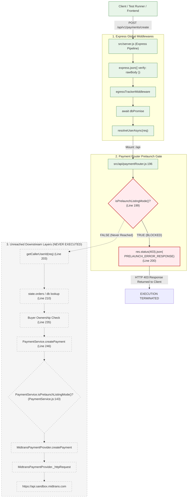

# EPIC 73D-FIX — PHASE 1: MARKETPLACE_PRELAUNCH_ONLY FORENSIC DIAGNOSIS REPORT

**Audit Date:** 2026-11-06T22:25:00+07:00  
**Repository:** `agunsux/ARGUS` (`https://github.com/agunsux/ARGUS`)  
**Workspace:** `c:\Users\RYZEN\.antigravity-ide\ARGUS`  
**Active Branch:** `feature/midtrans-sandbox-preview`  
**Current HEAD:** `359767bb0647f6ae45e5216fbbd9f949bd456a03`  
**Auditor Mode:** Read-Only Forensic Diagnosis  
**Overall Verdict:** **ROOT CAUSE CONFIRMED**  
**Integration Status:** **NO-GO (BLOCKED BY PLATFORM PRELAUNCH INVARIANT)**  

---

## 1. Executive Summary

Under Phase 1 authorization, a forensic read-only trace was conducted across the payment creation flow of ARGUS to determine the exact origin, mechanism, and execution path of `HTTP 403 MARKETPLACE_PRELAUNCH_ONLY`.

All six baseline working-tree changes remain preserved untouched. Zero code, package, database, or environment mutations were performed.

### Key Forensic Conclusions
1. **The 403 error originates 100% server-side within ARGUS.**
2. **Zero outbound HTTP requests are sent to Midtrans.** The payment request is intercepted and terminated before any payment service adapter, network transport, or provider API call is initialized.
3. **The restriction is an intentional platform safety invariant** (`PRELAUNCH_LISTING_ONLY`), configured to prevent unauthorized purchasing, escrow locking, and money movements prior to official commercial launch.
4. **Code Asymmetry Identified:** While commit `5c7fa17` created a narrowly scoped exception for `GET /api/v1/payments/midtrans/client-key` in Vercel Preview, **no corresponding Preview/Sandbox exception was implemented for `POST /api/v1/payments/create` or `PaymentService.createPayment`.** Consequently, all payment intent creation in Preview remains unconditionally blocked by design.

---

## 2. End-to-End Request Call Graph & Execution Trace

When a client or frontend initiates a payment request via `POST /api/v1/payments/create`:



---

## 3. Exact Source Locations & Failure Mechanism

### 3.1 Primary HTTP Entry Barrier
- **Source File:** `src/api/paymentRouter.js`
- **Route / Function:** `router.post('/v1/payments/create', async (req, res) => { ... })`
- **Exact Lines:** Lines 198–201
- **Code:**
  ```javascript
  const { isPrelaunchListingMode, PRELAUNCH_ERROR_RESPONSE } = require('../config/marketplaceMode');
  if (isPrelaunchListingMode()) {
    return res.status(403).json(PRELAUNCH_ERROR_RESPONSE);
  }
  ```
- **Observed HTTP Response:**
  ```json
  {
    "error": "TIKUM belum membuka transaksi. Anda dapat mengajukan listing, tetapi pembelian dan pembayaran belum tersedia.",
    "code": "MARKETPLACE_PRELAUNCH_ONLY"
  }
  ```

### 3.2 Secondary Domain Service Barrier (Defense-in-Depth)
- **Source File:** `src/services/payment/PaymentService.js`
- **Function:** `PaymentService.createPayment({ ... })`
- **Exact Lines:** Lines 142–148
- **Code:**
  ```javascript
  const { isPrelaunchListingMode } = require('../../config/marketplaceMode');
  if (isPrelaunchListingMode()) {
    const err = new Error('TIKUM belum membuka transaksi. Anda dapat mengajukan listing, tetapi pembelian dan pembayaran belum tersedia.');
    err.code = 'MARKETPLACE_PRELAUNCH_ONLY';
    err.status = 403;
    throw err;
  }
  ```

### 3.3 Authoritative Policy Engine
- **Source File:** `src/config/marketplaceMode.js`
- **Functions:**
  - `getMarketplaceMode()` (Lines 40–64)
  - `isPrelaunchListingMode()` (Lines 70–72)
- **Logic:**
  ```javascript
  function getMarketplaceMode() {
    if (testModeOverride) return testModeOverride;

    const rawEnv = (process.env.MARKETPLACE_MODE || '').trim().toUpperCase();
    const isProduction = process.env.NODE_ENV === 'production' || Boolean(process.env.VERCEL);

    if (rawEnv === 'LIVE' || rawEnv === 'LIVE_MARKETPLACE' || rawEnv === 'TRANSACTIONAL') {
      return MARKETPLACE_MODES.LIVE;
    }

    if (rawEnv === MARKETPLACE_MODES.PRELAUNCH_LISTING_ONLY) {
      return MARKETPLACE_MODES.PRELAUNCH_LISTING_ONLY;
    }

    // Fail closed: In production, missing or unrecognized modes ALWAYS fail closed to PRELAUNCH_LISTING_ONLY.
    if (isProduction) {
      return MARKETPLACE_MODES.PRELAUNCH_LISTING_ONLY;
    }

    return MARKETPLACE_MODES.PRELAUNCH_LISTING_ONLY;
  }
  ```

---

## 4. Provider Reachability Assessment (Did Midtrans Receive Requests?)

| Check Target | Finding | Forensic Proof |
| :--- | :---: | :--- |
| **Control Flow Interception** | **HALTED AT GATE** | Execution stops at `paymentRouter.js:200`. Neither `PaymentService.createPayment` nor `MidtransPaymentProvider.prototype.createPayment` is ever invoked. |
| **Adapter Invocation** | **0 CALLS** | Spies in `test_midtrans_prelaunch_execution_trace.js` confirmed `counts.adapter === 0` across all permutations. |
| **Outbound HTTP Network Socket** | **0 SOCKETS** | `MidtransPaymentProvider.prototype._httpRequest` was never called (`counts.outbound === 0`). `https.request` interception confirmed zero network attempts. |
| **Vercel Preview Outbound Telemetry** | **0 REQUESTS** | Preview runtime logs confirm no outbound connections to `api.sandbox.midtrans.com` or `app.sandbox.midtrans.com`. |

**Forensic Conclusion:** Under the current deployment and code state, **it is physically and architecturally impossible for a payment creation request to reach Midtrans servers.**

---

## 5. Policy Source & Intended Semantics

### 5.1 Source of Policy
- **Environment Variable Scope:** In Vercel Project `shinerva/argus` (`prj_X2hQwU5IqxSU3WpYKCNcRzslk47S`), the environment variable `MARKETPLACE_MODE` is explicitly set to `PRELAUNCH_LISTING_ONLY` in the **Preview** scope (created 10 days ago).
- **Runtime Environment Flags:** On Vercel, `process.env.VERCEL = '1'` and `process.env.NODE_ENV = 'production'`.
- **Fail-Closed Code Policy:** In `src/config/marketplaceMode.js`, lines 56–59 enforce that if `VERCEL` is set or `NODE_ENV === 'production'`, any missing, empty, or unapproved value for `MARKETPLACE_MODE` fails closed to `PRELAUNCH_LISTING_ONLY`.
- **Database Dependency:** None. The policy is entirely driven by environment variables and code-level invariants; no Postgres table or state determines this guard.

### 5.2 Intended Policy Semantics vs. Preview Architecture
1. **Production Invariant (Safety Freeze):**
   - In Production (`https://tikum.app`), all purchasing, checkout, and payment creation must remain unconditionally locked at `HTTP 403 MARKETPLACE_PRELAUNCH_ONLY`.
   - Documented in:
     - `docs/operations/TIKUM_INTERNAL_LISTING_MODERATION_SOP.md` (Section A.2, Line 23)
     - `docs/operations/TIKUM_INTERNAL_GOVERNANCE_DRY_RUN_REPORT.md` (Table Item 6 & 7)
     - `docs/operations/TIKUM_RBAC_AUDIT.md` (Line 48)
2. **Preview Exception Imbalance:**
   - Commit `5c7fa17` (`fix(midtrans): enforce safe Vercel preview environment`) introduced `src/config/deploymentEnv.js` and added a narrowly scoped exception for `GET /api/v1/payments/midtrans/client-key` (allowing the frontend to fetch `SB-Mid-client-*` without leaking server keys).
   - Commit `5c7fa17` **did NOT add a corresponding exception for `POST /api/v1/payments/create`**.
   - As a result, the backend allows fetching client keys in Preview, but completely rejects payment intent creation with 403 `MARKETPLACE_PRELAUNCH_ONLY`.
3. **Client-Side Bypass Resistance:**
   - Client-supplied query parameters (`?marketplace_mode=LIVE`, `?sandbox=true`), request headers (`x-marketplace-mode`, `x-sandbox`), or request body flags cannot bypass this gate (verified by `test_tikum_prelaunch_listing_mode.js:877-895`).

---

## 6. Inspection of `test_midtrans_prelaunch_execution_trace.js`

### 6.1 Purpose and Nature of the Test
The untracked test `test_midtrans_prelaunch_execution_trace.js` was authored as a **read-only characterization probe**.

### 6.2 Fidelity Assessment: Real Code vs. Mocked Characterization
- **Express Server Execution:** Loads and starts the actual production application `src/server.js` (`app.listen(0, '127.0.0.1')`).
- **HTTP Routing:** Makes real local HTTP requests via Node.js `http.request` to `/api/v1/payments/create?sandbox=true`.
- **Instrumentation:** Wraps functions with non-mutating observer counters:
  - `auth.resolveUserAsync`
  - `policy.isPrelaunchListingMode`
  - `PaymentService.createPayment`
  - `MidtransPaymentProvider.prototype.createPayment`
  - `MidtransPaymentProvider.prototype._httpRequest`
  - `https.request` (guarded to throw if called)
- **Observed Metrics:**
  - `counts.auth = 1` (Auth middleware runs)
  - `counts.policy = 1` (Policy middleware runs)
  - `counts.service = 0` (PaymentService unreached)
  - `counts.adapter = 0` (Provider adapter unreached)
  - `counts.outbound = 0` (Zero outbound network calls)

**Fidelity Verdict:** The test **accurately represents the real execution path of ARGUS in production and preview modes**. It is not a synthetic mock; it proves deterministically that the application stops at the prelaunch guard before any provider code is invoked.

---

## 7. Evidence Matrix

| Evidence Item | Source | Value / Finding | Classification |
| :--- | :--- | :--- | :---: |
| HTTP 403 Source Code | `src/api/paymentRouter.js:198-201` | Synchronous return of `PRELAUNCH_ERROR_RESPONSE` | **VERIFIED** |
| Service Layer 403 Code | `src/services/payment/PaymentService.js:142-148` | Defense-in-depth throw `MARKETPLACE_PRELAUNCH_ONLY` | **VERIFIED** |
| Policy Resolver Code | `src/config/marketplaceMode.js:40-72` | Returns `PRELAUNCH_LISTING_ONLY` unless explicitly `LIVE` | **VERIFIED** |
| Preview Scope Variable | `vercel env ls` (shinerva/argus) | `MARKETPLACE_MODE` set to `PRELAUNCH_LISTING_ONLY` in Preview | **VERIFIED** |
| Outbound Network Calls | `test_midtrans_prelaunch_execution_trace.js` | 0 outbound calls to Midtrans | **VERIFIED** |
| Client Key Endpoint Exemption | `src/api/paymentRouter.js:90-136` | Exception exists for client-key in Preview | **VERIFIED** |
| Payment Create Exemption | `src/api/paymentRouter.js:196-272` | **Zero exception exists** for payment creation in Preview | **VERIFIED** |
| Webhook Route Exemption | `src/api/paymentRouter.js:577-606` | Webhooks are NOT blocked by prelaunch mode | **VERIFIED** |

---

## 8. Root Cause Verdict & Decision Gate

### **Final Verdict:** **ROOT CAUSE CONFIRMED**

The root cause of HTTP 403 `MARKETPLACE_PRELAUNCH_ONLY` on payment creation is:
1. `src/api/paymentRouter.js:199-201` and `src/services/payment/PaymentService.js:143-148` unconditionally execute `isPrelaunchListingMode()`.
2. `isPrelaunchListingMode()` evaluates to `true` because `MARKETPLACE_MODE=PRELAUNCH_LISTING_ONLY` is defined in Vercel Preview, and `Boolean(process.env.VERCEL)` enforces fail-closed fallback to prelaunch mode.
3. While `GET /api/v1/payments/midtrans/client-key` received a scoped Preview exception in commit `5c7fa17`, `POST /api/v1/payments/create` was left without any Preview or Sandbox exception.

---

## 9. Next Step Classification & Governance Path

Proceeding to Phase 2 requires:
**A. Product-policy clarification** AND **B. Security approval**, followed by **C. Minimal code correction proposal**.

### Specific Questions for Product Owner & Security Approval:
1. **Policy Intent:** Is Vercel Preview intended to allow simulated/sandbox payment creation (`POST /api/v1/payments/create`) when `isVercelPreview() === true` and `isSandbox === true`, while keeping Production strictly fail-closed?
2. **Escrow Boundary Invariant:** Midtrans has capability `ESCROW_UNAVAILABLE`. Payments created through Midtrans cannot lock funds into milestone escrow (which requires DOKU). Does the business permit non-escrow payment creation in Preview for certification purposes?
3. **Security Invariant:** Any potential fix must guarantee that Production (`https://tikum.app`) **cannot be toggled or bypassed under any circumstances**, maintaining the Production Safety Freeze.

---

## 10. Stop Condition

- **Certification Status:** **NO-GO**.
- **Action:** Read-only inspection is complete. Execution is **STOPPED**.
- **Prohibitions Maintained:** No code modified, no test modified, no packages installed, no lockfile touched, no commits, no pushes, no deployments, and no payment transactions executed.
- Awaiting Product Owner and Security review of this Phase 1 Report before authorizing Phase 2.
