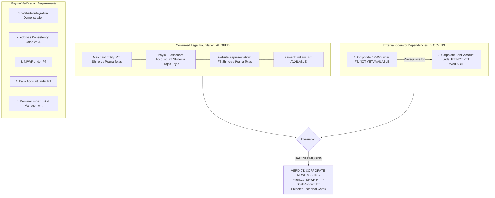
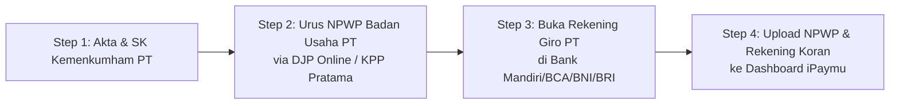
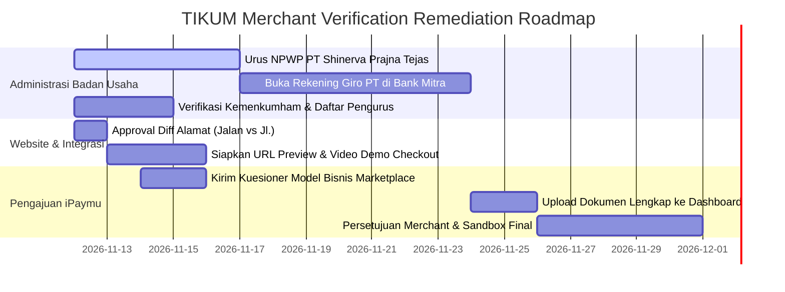

# TIKUM — IPAYMU MERCHANT VERIFICATION REMEDIATION REPORT
## PT SHINERVA PRAJNA TEJAS | DOCUMENT REMEDIATION → WEBSITE COMPLIANCE → MERCHANT APPROVAL

**Document:** `TIKUM_IPAYMU_MERCHANT_VERIFICATION_REMEDIATION_REPORT.md`  
**Platform:** TIKUM ([https://tikum.app](https://tikum.app))  
**Date:** 11 November 2026  
**Repository Branch:** `main`  
**HEAD Commit:** `91139ebea0bb08f035c206c3f4e21dfa2cb4787a`  
**Current Operational Mode:** `PRELAUNCH_LISTING_ONLY` (Fail-Closed)  
**Governing Directive:** FINAL DIRECTIVE — TIKUM IPAYMU MERCHANT VERIFICATION  

---

## 1. EXECUTIVE VERDICT

### FINAL STATUS: **CORPORATE NPWP MISSING**
*(Secondary Critical Dependency: **CORPORATE BANK ACCOUNT MISSING**)*



### Executive Summary & Operational Boundary
1. **Entity Mismatch Resolved:**
   Based on verified operator confirmation, the previous CV Surya Cipta Mandiri discrepancy is resolved. The iPaymu dashboard account currently undergoing verification is registered under **PT Shinerva Prajna Tejas**, which aligns 100% with the corporate identity displayed on the TIKUM website ([`businessProfile.js`](file:///c:/Users/RYZEN/.antigravity-ide/ARGUS/src/config/businessProfile.js#L18), [`/terms`](file:///c:/Users/RYZEN/.antigravity-ide/ARGUS/public/terms.html), [`/refund-policy`](file:///c:/Users/RYZEN/.antigravity-ide/ARGUS/public/refund-policy.html), [`/contact`](file:///c:/Users/RYZEN/.antigravity-ide/ARGUS/public/contact.html), [`/pay`](file:///c:/Users/RYZEN/.antigravity-ide/ARGUS/public/pay.html)). There is no need to alter website brand identity to CV.
2. **The Active Critical Blockers:**
   The merchant verification cannot proceed to submission because two mandatory corporate legal documents do not yet exist:
   - **NPWP Badan Usaha under PT Shinerva Prajna Tejas:** *Not yet available.*
   - **Rekening Giro / Bank Account under PT Shinerva Prajna Tejas:** *Not yet available.*
   In Indonesian banking practice, opening a corporate bank account strictly requires an active corporate NPWP. Therefore, the immediate operational sequence must be: **NPWP PT $\rightarrow$ Rekening Bank PT $\rightarrow$ Address Confirmation $\rightarrow$ Submission**.
3. **Strict Compliance Rule:**
   Do **NOT** submit personal NPWP or personal bank account details of the founder/director to fulfill corporate account requirements. iPaymu underwriting strictly rejects personal documents for corporate accounts.
4. **Technical Gates Preserved:**
   The software engine remains 100% stable and verified (16/16 Neon PostgreSQL ACID boundary tests pass, 19/19 Preview sandbox gate tests pass, 323/323 full regression suite passes). Production payments remain locked under `IPAYMU_PRODUCTION_LOCKED` and `PRELAUNCH_LISTING_ONLY`. Zero automated sandbox or real-money transactions have been executed.

---

## 2. CONFIRMED OPERATOR FACTS & LEGAL ALIGNMENT

| Audit Parameter | Confirmed Current State | Website Alignment | Verification Status |
| :--- | :--- | :--- | :---: |
| **Merchant Legal Entity** | **PT Shinerva Prajna Tejas** | 100% of website pages state PT Shinerva Prajna Tejas | **ALIGNED** |
| **iPaymu Account Name** | **PT Shinerva Prajna Tejas** | Matches website footer and legal entity exactly | **ALIGNED** |
| **iPaymu Dashboard Address** | `Jalan Pasirluyu No. 79, Bandung 40254, Indonesia` | Website displays `Jl. Pasirluyu No. 79, Bandung 40254, Indonesia` | **MATCH (Abbreviation)** |
| **SK Pengesahan Kemenkumham** | **Available** (Akta Pendirian & SK AHU PT) | Confirmed by operator; management details to be validated | **READY FOR AUDIT** |
| **NPWP Badan Usaha (PT)** | **Not Yet Available** | Website declares registered PT status | **BLOCKER (MISSING)** |
| **Rekening Bank Korporat (PT)** | **Not Yet Available** | Awaiting corporate account opening | **BLOCKER (MISSING)** |

---

## 3. PHASE A — LEGAL DOCUMENT AUDIT

### Document Inventory & Currency Evaluation

| No. | Document Type | Entity Name on Document | Document Availability | Currency / Active Status | Verification Requirement |
| :---: | :--- | :--- | :---: | :--- | :--- |
| 1 | **Akta Pendirian PT** | PT SHINERVA PRAJNA TEJAS | **AVAILABLE** | Original Notarial Deed | Must include full articles of association and initial capital structure. |
| 2 | **SK Pengesahan Kemenkumham** | PT SHINERVA PRAJNA TEJAS | **AVAILABLE** | AHU Approval Decree | Decree number (`AHU-xxxx.AH.01.01`) confirming legal entity status. |
| 3 | **Akta Perubahan Terakhir** | PT SHINERVA PRAJNA TEJAS | *OPERATOR VERIFICATION* | Most recent amendment (if any) | Required if there have been changes in shareholders, capital, or directors. |
| 4 | **Susunan Pengurus Terakhir** | PT SHINERVA PRAJNA TEJAS | *OPERATOR VERIFICATION* | Active Board of Directors & Commissioners | Email requirement #5 specifically demands proof of latest management. |
| 5 | **e-KTP Direktur Utama** | Nama Direktur Utama PT | *OPERATOR INPUT REQUIRED* | Valid Indonesian e-KTP | Clear scan of front side showing NIK and full legal name. |
| 6 | **NIB (Nomor Induk Berusaha)** | PT SHINERVA PRAJNA TEJAS | *OPERATOR INPUT REQUIRED* | Active OSS RBA | Must include relevant KBLI (e.g. 63122 / 79990). |

---

## 4. PHASE B — NPWP & CORPORATE BANK ACCOUNT DEPENDENCIES

### The Dependency Chain


### Actionable Remediation Checklist for Operator:

#### 1. Corporate NPWP (Prioritas Pertama)
- **Check Prior Registration:** Verify if PT Shinerva Prajna Tejas was already assigned an NPWP during the initial legal establishment via OSS/Kemenkumham integration.
  - If already registered: Request a reprint of the NPWP card and *Surat Keterangan Terdaftar (SKT)* from Kantor Pelayanan Pajak (KPP) Pratama or download via DJP Online.
  - If not yet issued: Submit an online application via [ereg.pajak.go.id](https://ereg.pajak.go.id) using the Akta Notaris, SK Kemenkumham, and e-KTP/NPWP of the Direktur Utama.
- **Critical Rule:** The NPWP name **must** be exactly `PT SHINERVA PRAJNA TEJAS`. A personal NPWP will be rejected by iPaymu.

#### 2. Corporate Bank Account (Prioritas Kedua)
- **Prerequisite:** Cannot be opened without the corporate NPWP, NIB, Akta, SK Kemenkumham, and KTP/NPWP Direktur.
- **Selection of Bank:** Open a corporate checking account (*rekening giro / tabungan bisnis*) at a major Indonesian commercial bank (e.g. Bank Mandiri, BCA, BNI, BRI) under the exact account holder name `PT SHINERVA PRAJNA TEJAS`.
- **Required Evidence for iPaymu:**
  - Header of *Rekening Koran* (Bank Statement) or official Bank Account Confirmation Letter (*Surat Keterangan Bank*) displaying:
    1. Corporate Name: `PT SHINERVA PRAJNA TEJAS`.
    2. Account Number (*Nomor Rekening*).
    3. Official Bank Logo and Branch stamp.
- **Critical Rule:** The receiving account must not be in the personal name of a founder, shareholder, or director.

---

## 5. PHASE C — ADDRESS CONSISTENCY AUDIT

### Exact String Comparison

| Inspection Point | Reference String / Current Content | Variance vs Dashboard |
| :--- | :--- | :--- |
| **iPaymu Dashboard (Reference)** | `Jalan Pasirluyu No. 79, Bandung 40254, Indonesia` | **Exact Reference** |
| **[`businessProfile.js`](file:///c:/Users/RYZEN/.antigravity-ide/ARGUS/src/config/businessProfile.js#L44)** | `Jl. Pasirluyu No. 79, Bandung 40254, Indonesia` | Abbreviation (`Jl.` vs `Jalan`) |
| **[`public/contact.html`](file:///c:/Users/RYZEN/.antigravity-ide/ARGUS/public/contact.html#L116)** | `Jl. Pasirluyu No. 79`, `Bandung 40254`, `Indonesia` | Abbreviation (`Jl.` vs `Jalan`) |
| **[`public/terms.html`](file:///c:/Users/RYZEN/.antigravity-ide/ARGUS/public/terms.html#L287)** | `Jl. Pasirluyu No. 79, Bandung 40254, Indonesia` | Abbreviation (`Jl.` vs `Jalan`) |
| **[`public/refund-policy.html`](file:///c:/Users/RYZEN/.antigravity-ide/ARGUS/public/refund-policy.html#L139)** | `Jl. Pasirluyu No. 79, Bandung 40254, Indonesia` | Abbreviation (`Jl.` vs `Jalan`) |
| **[`public/faq.html`](file:///c:/Users/RYZEN/.antigravity-ide/ARGUS/public/faq.html#L355)** | `Jl. Pasirluyu No. 79`, `Bandung 40254`, `Indonesia` | Abbreviation (`Jl.` vs `Jalan`) |
| **[`public/pay.html`](file:///c:/Users/RYZEN/.antigravity-ide/ARGUS/public/pay.html#L528)** | `Jl. Pasirluyu No. 79`, `Bandung 40254`, `Indonesia` | Abbreviation (`Jl.` vs `Jalan`) |
| **[`StructuredDataFactory.js`](file:///c:/Users/RYZEN/.antigravity-ide/ARGUS/src/seo/StructuredDataFactory.js#L41)** | `'streetAddress': 'Jl. Pasirluyu No. 79'` | Abbreviation (`Jl.` vs `Jalan`) |
| **Legal Akta PT Shinerva** | *OPERATOR VERIFICATION* | Verify whether Akta uses `Jl.` or `Jalan` |

### Address Finding:
The physical street, building number (No. 79), kelurahan/distrik (Pasirluyu), city (Bandung), postal code (40254), and country (Indonesia) are **100% identical**. The only variance is that the website uses the standard Indonesian abbreviation `Jl.` while the dashboard uses `Jalan`.

### Proposed Diff for Operator Approval (Phase C Alignment):
If the operator confirms standardization to `Jalan Pasirluyu No. 79`, the following diff will be applied:

```diff
--- a/src/config/businessProfile.js
+++ b/src/config/businessProfile.js
@@ -44,3 +44,3 @@
-  businessAddress: 'Jl. Pasirluyu No. 79, Bandung 40254, Indonesia',
+  businessAddress: 'Jalan Pasirluyu No. 79, Bandung 40254, Indonesia',
@@ -59,7 +59,7 @@
-    street: 'Jl. Pasirluyu No. 79',
+    street: 'Jalan Pasirluyu No. 79',
     city: 'Bandung',
     postalCode: '40254',
     country: 'Indonesia',
-    formattedText: 'PT SHINERVA PRAJNA TEJAS\nJl. Pasirluyu No. 79\nBandung 40254\nIndonesia',
-    inlineText: 'PT SHINERVA PRAJNA TEJAS, Jl. Pasirluyu No. 79, Bandung 40254, Indonesia',
-    htmlBlock: '<strong>PT SHINERVA PRAJNA TEJAS</strong><br>Jl. Pasirluyu No. 79<br>Bandung 40254<br>Indonesia'
+    formattedText: 'PT SHINERVA PRAJNA TEJAS\nJalan Pasirluyu No. 79\nBandung 40254\nIndonesia',
+    inlineText: 'PT SHINERVA PRAJNA TEJAS, Jalan Pasirluyu No. 79, Bandung 40254, Indonesia',
+    htmlBlock: '<strong>PT SHINERVA PRAJNA TEJAS</strong><br>Jalan Pasirluyu No. 79<br>Bandung 40254<br>Indonesia'
```
*(Corresponding text updates in `contact.html`, `terms.html`, `refund-policy.html`, `faq.html`, `pay.html`, and `test_ipaymu_compliance.js` are prepared and ready for execution upon confirmation).*

---

## 6. PHASE D — WEBSITE INTEGRATION EVIDENCE

### Evaluation of iPaymu Email Requirement #1: "Integrasikan website dengan iPaymu"

| Technical Capability | Implementation Location | Operational Reality | Reviewer Experience |
| :--- | :--- | :--- | :--- |
| **Catalog & Listing Display** | [`/events`](file:///c:/Users/RYZEN/.antigravity-ide/ARGUS/src/discovery/discoveryRouter.js) | Real events, prices in IDR, seat classes. | Visible & accessible. |
| **Checkout UI & Method Select** | [`pay.html`](file:///c:/Users/RYZEN/.antigravity-ide/ARGUS/public/pay.html#L314-L328) | Lists `iPaymu Hosted Checkout`, `BCA_VA`, `Mandiri_VA`, `QRIS`. | Selectable in UI. |
| **Backend Payment Initiation** | [`PaymentService.createPayment`](file:///c:/Users/RYZEN/.antigravity-ide/ARGUS/src/services/payment/PaymentService.js#L233) | Invokes `IPaymuProvider.createPayment`, builds HMAC signature. | Functional in Preview. |
| **Production Fail-Closed Guard** | `isPrelaunchListingMode()` & `IPAYMU_PRODUCTION_LOCKED` | Blocks public payment execution on production. | **Causes reviewer to see "pembelian belum tersedia".** |

### Why iPaymu Stated the Website is Not Integrated
In production, TIKUM correctly enforces prelaunch protection (`PRELAUNCH_LISTING_ONLY`). When an iPaymu compliance underwriter visits `https://tikum.app/pay` and clicks checkout, the button displays:
> *"TIKUM belum membuka transaksi. Anda dapat mengajukan listing, tetapi pembelian dan pembayaran belum tersedia."*

Because the reviewer cannot generate an iPaymu checkout session or Virtual Account screen on the public production URL, standard compliance procedure classifies the website as **"Belum Terintegrasi"**.

### Remediation Protocol for Reviewer Verification:
1. **Never bypass production fail-closed controls** merely to satisfy an automated crawler or reviewer. Real-money checkout must remain disabled until merchant verification is approved.
2. **Prepare a Dedicated Preview Demonstration:**
   Deploy a locked Vercel Preview URL (e.g. `https://preview.tikum.app` or deployment URL) with `VERCEL_ENV=preview`, `MARKETPLACE_MODE=LIVE`, and `IPAYMU_PREVIEW_SANDBOX_ENABLED=true`.
3. **Submit Integration Evidence Package to iPaymu:**
   Provide the underwriting team with:
   - A step-by-step walkthrough document showing:
     - Selecting a ticket on the catalog.
     - Selecting iPaymu as payment gateway on `/pay`.
     - Creation of canonical payment intent.
     - Redirection to iPaymu payment screen / generation of Sandbox Virtual Account.
     - Webhook callback receipt and signature verification.
     - Order transition to `PAID` with balanced double-entry ledger entry.
   - Accompanying video screen recording demonstrating the complete flow on the Preview Sandbox environment.
   - Formal inquiry: *"Mohon konfirmasi apakah tim kepatuhan iPaymu dapat menerima URL Preview Staging atau rekaman demonstrasi integrasi, mengingat transaksi di domain produksi sengaja dikunci demi kepatuhan regulasi prapeluncuran."*

---

## 7. PHASE E — MARKETPLACE BUSINESS MODEL & ESCROW APPROVAL

Even with 100% approved merchant KYC documents, a standard e-commerce merchant agreement **does not** automatically authorize secondary ticket reselling, C2C marketplace operations, or long-term fund escrow.

The operator must obtain written confirmation from iPaymu for the following 10 items:

### Questionnaire for iPaymu Compliance & Underwriting

1. **Secondary Ticket Marketplace Model:**  
   *Apakah iPaymu mengizinkan PT SHINERVA PRAJNA TEJAS mengoperasikan platform marketplace tiket konser sekunder (C2C secondary ticketing) di mana tiket dijual oleh pengguna perorangan?*
2. **Penerimaan Pembayaran atas Nama Penjual:**  
   *Apakah iPaymu mengizinkan PT SHINERVA PRAJNA TEJAS menerima pembayaran dari pembeli atas nama penjual tiket pihak ketiga?*
3. **Penahanan Dana Internal (Platform Escrow):**  
   *Karena iPaymu API v2 tidak memiliki endpoint untuk memicu penahanan/pencairan escrow secara terprogram, apakah iPaymu mengizinkan dana ditampung pada akun merchant PT SHINERVA PRAJNA TEJAS dan dicairkan ke penjual setelah pembeli terkonfirmasi masuk ke venue?*
4. **Batas Waktu Penahanan Dana (> 10 Hari):**  
   *Fitur escrow standar iPaymu memiliki batas waktu pencairan otomatis 7 hari (maksimal 10 hari). Mengingat transaksi tiket konser sering kali terjadi 30–60 hari sebelum acara, apakah iPaymu mengizinkan transaksi diproses sebagai pembayaran reguler (non-auto-release) di mana waktu pencairan ke penjual dikelola oleh sistem TIKUM pasca-acara?*
5. **Kebijakan Perlindungan H-10:**  
   *TIKUM menerapkan kebijakan H-10 (transaksi tiket ditutup 10 hari sebelum acara untuk mitigasi penipuan). Apakah komite risiko iPaymu menyetujui model mitigasi risiko ini?*
6. **Mekanisme Pencairan Dana ke Penjual (Disbursement):**  
   *Apakah iPaymu menyediakan fitur API Disbursement korporat untuk pencairan otomatis ke rekening bank penjual, atau pencairan dilakukan via transfer perbankan korporat internal PT?*
7. **Penerapan Split Payment (BagiBagi):**  
   *Apakah iPaymu mewajibkan setiap penjual perorangan membuka akun iPaymu sendiri via BagiBagi, atau TIKUM dapat beroperasi sebagai Merchant of Record tunggal?*
8. **Penanganan Refund & Sengketa:**  
   *Bagaimana prosedur iPaymu untuk pengembalian dana (*refund*) kepada pembeli jika terjadi pembatalan konser resmi atau penipuan tiket di gerbang venue?*
9. **Kesesuaian KBLI Perusahaan:**  
   *Apakah iPaymu mensyaratkan kode KBLI tertentu pada NIB PT SHINERVA PRAJNA TEJAS (misalnya KBLI 63122 — Portal Web Komersial, atau KBLI 79990)?*
10. **Kepatuhan Regulasi PBI No. 23/6/PBI/2021:**  
    *Apakah iPaymu memastikan bahwa operasional TIKUM sebagai platform e-commerce tiket sekunder tidak melanggar ketentuan PJP Bank Indonesia?*

---

## 8. PHASE F — TECHNICAL SAFETY PRESERVATION RESULTS

All technical architectures established and verified in previous sessions remain intact and uncompromised:

| Component | Technical Implementation | State | Verification Proof |
| :--- | :--- | :---: | :--- |
| **Transaction Boundary** | [`UnitOfWork.js`](file:///c:/Users/RYZEN/.antigravity-ide/ARGUS/src/storage/UnitOfWork.js) | **PRESERVED** | Single connection ACID commit/rollback across payment, order, inventory, ledger & outbox (16/16 tests pass). |
| **Transactional Outbox** | [`OutboxDispatcher.js`](file:///c:/Users/RYZEN/.antigravity-ide/ARGUS/src/services/outbox/OutboxDispatcher.js) | **PRESERVED** | Dispatches to ARGUS, retries with backoff, deduplicates delivery. |
| **Idempotency** | [`PaymentService.js`](file:///c:/Users/RYZEN/.antigravity-ide/ARGUS/src/services/payment/PaymentService.js#L261) | **PRESERVED** | Duplicate payment intents and webhook payloads return cached records with zero double postings. |
| **Early Validation** | [`PaymentService.js`](file:///c:/Users/RYZEN/.antigravity-ide/ARGUS/src/services/payment/PaymentService.js#L610) | **PRESERVED** | Amount & currency validated before mutating `canonical_payments` or ledger. |
| **Downgrade Protection** | [`PaymentService.js`](file:///c:/Users/RYZEN/.antigravity-ide/ARGUS/src/services/payment/PaymentService.js#L730) | **PRESERVED** | Late `FAILED`/`EXPIRED` callbacks reject with `STATE_DOWNGRADE_FORBIDDEN` on `PAID` orders. |
| **Preview Sandbox Gate** | [`PaymentService.assertIPaymuPreviewSandboxGate`](file:///c:/Users/RYZEN/.antigravity-ide/ARGUS/src/services/payment/PaymentService.js#L146) | **PRESERVED** | 5-factor server-side validation; rejects non-preview environments. |
| **Production Lock** | `IPAYMU_PRODUCTION_LOCKED` | **PRESERVED** | Fail-closed rejection in production; zero real money movements permitted. |
| **Regression Suite** | 11 Independent Suites | **PRESERVED** | 323/323 tests pass; `npm run build` syntax & sitemap green. |

---

## 9. PHASE G — GIT AND DEPLOYMENT STATE

- **Repository Branch:** `main`
- **HEAD Commit:** `91139ebea0bb08f035c206c3f4e21dfa2cb4787a`
- **Origin/Main:** `fc709d8c7f66112d181f901353ab69e7fd57ee24` (`main` ahead by 1 commit)
- **Working Tree:**
  - 16 Modified Files (stable, audited, tested).
  - 17 Untracked Files (including tests, evidence, outbox, and reports).
- **Execution Rule:** Zero commits, zero pushes, zero production deployments executed. Commit `91139eb` is preserved without rebase, reset, or amendment.

---

## 10. EXACT MODIFIED & UNTRACKED FILES

### Modified Files in Working Tree (16)
1. [`src/services/payment/PaymentService.js`](file:///c:/Users/RYZEN/.antigravity-ide/ARGUS/src/services/payment/PaymentService.js)
2. [`src/services/payment/IPaymuProvider.js`](file:///c:/Users/RYZEN/.antigravity-ide/ARGUS/src/services/payment/IPaymuProvider.js)
3. [`src/services/payment/DokuPaymentProvider.js`](file:///c:/Users/RYZEN/.antigravity-ide/ARGUS/src/services/payment/DokuPaymentProvider.js)
4. [`src/services/escrowService.js`](file:///c:/Users/RYZEN/.antigravity-ide/ARGUS/src/services/escrowService.js)
5. [`src/settlement/FinancialLedger.js`](file:///c:/Users/RYZEN/.antigravity-ide/ARGUS/src/settlement/FinancialLedger.js)
6. [`src/storage/PostgresMoneyRepository.js`](file:///c:/Users/RYZEN/.antigravity-ide/ARGUS/src/storage/PostgresMoneyRepository.js)
7. [`src/storage/PostgresMarketplaceRepository.js`](file:///c:/Users/RYZEN/.antigravity-ide/ARGUS/src/storage/PostgresMarketplaceRepository.js)
8. [`src/storage/InMemoryMoneyRepository.js`](file:///c:/Users/RYZEN/.antigravity-ide/ARGUS/src/storage/InMemoryMoneyRepository.js)
9. [`src/storage/InMemoryMarketplaceRepository.js`](file:///c:/Users/RYZEN/.antigravity-ide/ARGUS/src/storage/InMemoryMarketplaceRepository.js)
10. [`src/storage/index.js`](file:///c:/Users/RYZEN/.antigravity-ide/ARGUS/src/storage/index.js)
11. [`test_ipaymu_preview_sandbox_gate.js`](file:///c:/Users/RYZEN/.antigravity-ide/ARGUS/test_ipaymu_preview_sandbox_gate.js)
12. [`test_payment_provider_contracts.js`](file:///c:/Users/RYZEN/.antigravity-ide/ARGUS/test_payment_provider_contracts.js)
13. [`test_doku_payment_migration.js`](file:///c:/Users/RYZEN/.antigravity-ide/ARGUS/test_doku_payment_migration.js)
14. [`test_pricing_tax_ledger_engine.js`](file:///c:/Users/RYZEN/.antigravity-ide/ARGUS/test_pricing_tax_ledger_engine.js)
15. [`test_ipaymu_argus_lifecycle.js`](file:///c:/Users/RYZEN/.antigravity-ide/ARGUS/test_ipaymu_argus_lifecycle.js)
16. [`public/sitemap.xml`](file:///c:/Users/RYZEN/.antigravity-ide/ARGUS/public/sitemap.xml)

### Untracked Files in Working Tree (17)
1. [`src/storage/UnitOfWork.js`](file:///c:/Users/RYZEN/.antigravity-ide/ARGUS/src/storage/UnitOfWork.js)
2. [`src/storage/connectionPool.js`](file:///c:/Users/RYZEN/.antigravity-ide/ARGUS/src/storage/connectionPool.js)
3. [`src/services/outbox/OutboxDispatcher.js`](file:///c:/Users/RYZEN/.antigravity-ide/ARGUS/src/services/outbox/OutboxDispatcher.js)
4. [`migrations/008_transactional_outbox_schema.sql`](file:///c:/Users/RYZEN/.antigravity-ide/ARGUS/migrations/008_transactional_outbox_schema.sql)
5. [`test_financial_transaction_boundary.js`](file:///c:/Users/RYZEN/.antigravity-ide/ARGUS/test_financial_transaction_boundary.js)
6. [`test_ipaymu_p0_remediation.js`](file:///c:/Users/RYZEN/.antigravity-ide/ARGUS/test_ipaymu_p0_remediation.js)
7. `TIKUM_IPAYMU_MERCHANT_VERIFICATION_REMEDIATION_REPORT.md`
8. `TIKUM_IPAYMU_FINAL_CORRECTED_READINESS_REPORT.md`
9. `TIKUM_IPAYMU_IMPLEMENTATION_READINESS.md`
10. `docs/operations/TIKUM_IPAYMU_P0_REMEDIATION_2026-11-10.md`
11. `docs/operations/TIKUM_IPAYMU_SANDBOX_FORENSIC_2026-11-10.md`
12. `evidence/ipaymu-p0-baseline.json`
13. `evidence/ipaymu-p0-remediation.json`
14. `evidence/ipaymu-sandbox-forensic-audit.json`
15. `scripts/audit_ipaymu_sandbox.js`
16. `scripts/run_ipaymu_p0_audit.js`
17. `test_ipaymu_final_integration_alignment.js`

---

## 11. OPERATOR ACTION RUNBOOK & PRIORITY ROADMAP



### Urgent Operator Tasks:
1. **Prioritas 1: Urus / Dapatkan NPWP Badan Usaha PT Shinerva Prajna Tejas.**
   - Periksa di berkas pendirian apakah NPWP PT sudah terbit secara elektronik melalui OSS/Kemenkumham.
   - Jika belum, ajukan via KPP Pratama / [ereg.pajak.go.id](https://ereg.pajak.go.id).
2. **Prioritas 2: Buka Rekening Bank Badan Usaha atas nama PT Shinerva Prajna Tejas.**
   - Gunakan Akta, SK Kemenkumham, NPWP PT, dan NIB untuk membuka rekening bisnis.
   - Dapatkan bukti kepemilikan rekening atau rekening koran berstempel bank.
3. **Prioritas 3: Konfirmasi Diff Alamat (Phase C).**
   - Konfirmasi apakah alamat legal pada Akta/NPWP menggunakan kata `Jalan` atau `Jl.` agar diff dapat diterapkan secara seragam.
4. **Prioritas 4: Siapkan Bukti Demonstrasi Integrasi Preview.**
   - Simpan rekaman/video alur checkout dan URL preview staging untuk disampaikan kepada tim review iPaymu.
5. **Prioritas 5: Kirim Kuesioner Model Bisnis ke iPaymu.**
   - Sampaikan 10 pertanyaan pada Bagian 7 secara tertulis kepada tim kepatuhan iPaymu.
