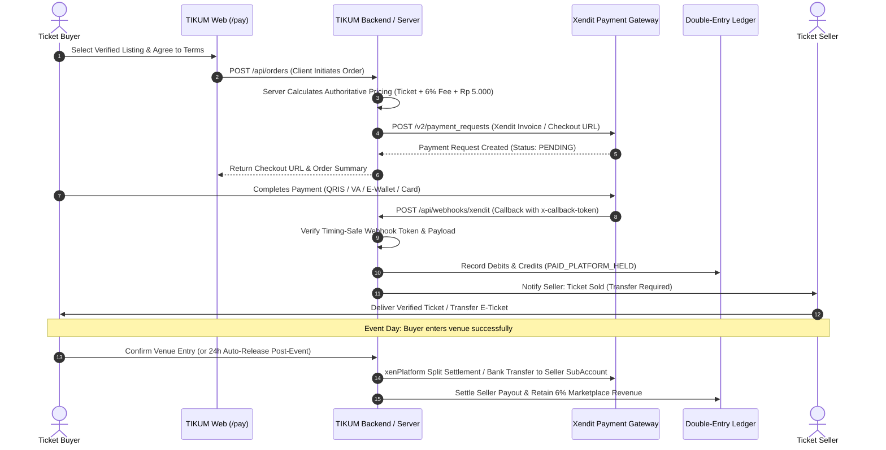

# TIKUM — Payment Architecture, Money Flows & Provider Integration
**Business Entity:** PT SHINERVA PRAJNA TEJAS  
**Platform:** TIKUM Secondary Ticket Marketplace (`https://tikum.app/`)  
**Payment Integration:** Xendit (xenPlatform Subaccounts & Split Payment Engine) / DOKU  
**Document Classification:** Technical Architecture & Compliance Specification

---

## 1. Executive Payment Flow Overview

TIKUM operates as a verified secondary ticket marketplace. To ensure buyer protection and prevent ticket fraud, funds paid by ticket buyers are **held internally by the platform** in a dedicated accounting ledger until the buyer has successfully accessed the event venue.



---

## 2. XenPlatform Capabilities vs. Escrow Reality

### 2.1 Why Third-Party Provider Escrow is Flagged Unsupported
In `src/services/payment/XenditPaymentProvider.js`, the capabilities contract explicitly declares:
```javascript
capabilities: {
  hold: false,
  release: false,
  splitSettlement: true,
  subAccounts: true,
  notes: 'Xendit xenPlatform supports split payments and sub-accounts. ' +
         'Third-party milestone escrow is not natively supported by Xendit API ' +
         '(funds settle immediately upon capture based on split rules). ' +
         'Platform-held accounting protection is managed internally by TIKUM ledger.'
}
```

### 2.2 Truthful Architecture: Internal Platform-Held Accounting Protection
1. **No Fake Provider Escrow:** TIKUM does not pretend that Xendit holds a conditional "milestone escrow hold". Calling `createHold()` or `releaseHold()` on the Xendit adapter deliberately throws `CapabilityUnsupportedError`.
2. **Platform-Held Settlement:** 
   - When a buyer pays via Xendit, the gross amount enters TIKUM's primary merchant balance.
   - The internal `Order` entity transitions to `PAID_PLATFORM_HELD`.
   - The `seller_payout_status` is locked as `LOCKED_PENDING_EVENT_COMPLETION`.
   - Payout to the seller is only triggered **after** the event has occurred and no dispute is lodged within 24 hours.
   - If the ticket is invalid or entry is denied, TIKUM executes a full refund directly to the buyer from the platform-held balance, and sanctions the seller under the 200% penalty clause.

---

## 3. Server-Authoritative Fee Engine & Double-Entry Ledger

TIKUM enforces strict server-side price calculation. The frontend is never trusted with totals, fees, or taxes.

### 3.1 Pricing Engine Formula
For a seller listing of price $P$:
- **Buyer Platform Fee:** $F_{\text{platform}} = \max(P \times 0.06, \text{IDR } 15.000)$
- **Payment Processing Fee:** $F_{\text{payment}} = \text{IDR } 5.000$
- **Total Buyer Price:** $P_{\text{buyer}} = P + F_{\text{platform}} + F_{\text{payment}}$
- **Seller Payout:** $P_{\text{seller}} = P$ (Seller receives 100% of listed price unless promotional seller fee applies)

### 3.2 Double-Entry Ledger Balance Equation
Every transaction is posted to the double-entry financial ledger (`AccountingLedger`) where debits and credits must balance to zero:
$$\sum \text{Debits} = \sum \text{Credits}$$

#### Example Transaction: IDR 500,000 Ticket
- Base Ticket Price: IDR 500,000
- Buyer Platform Fee (6%): IDR 30,000
- Payment Processing Fee: IDR 5,000
- Total Paid by Buyer: **IDR 535,000**

**Ledger Journal Entries Upon Payment Confirmation:**
| Account Code | Account Name | Debit (IDR) | Credit (IDR) | Note |
| :--- | :--- | :--- | :--- | :--- |
| `1010` | Cash / Xendit Clearing | 535,000 | 0 | Gross cash received at payment gateway |
| `2010` | Buyer Escrow Liability | 0 | 500,000 | Held for seller payout post-event |
| `4010` | Platform Fee Revenue | 0 | 30,000 | TIKUM marketplace service fee |
| `4020` | Payment Gateway Processing Fee | 0 | 5,000 | Pass-through processing fee |
| **Total** | | **535,000** | **535,000** | **BALANCED** |

**Ledger Journal Entries Upon Venue Entry Confirmation (Payout):**
| Account Code | Account Name | Debit (IDR) | Credit (IDR) | Note |
| :--- | :--- | :--- | :--- | :--- |
| `2010` | Buyer Escrow Liability | 500,000 | 0 | Liability extinguished |
| `1020` | Cash / Bank Disbursement | 0 | 500,000 | Disbursed to seller bank account |
| **Total** | | **500,000** | **500,000** | **BALANCED** |

---

## 4. Webhook Security & Tampering Protections

1. **Constant-Time Signature Verification:** Incoming Xendit callbacks must present the `x-callback-token` matching the environment secret. Tokens are verified using `crypto.timingSafeEqual` to prevent timing attacks.
2. **Amount & Currency Validation:** When Xendit notifies payment completion, the callback amount is compared against the database order expected amount. Any mismatch throws `HTTP 422 AMOUNT_MISMATCH` and suspends the transaction.
3. **Idempotency Replay Protection:** Duplicate webhooks are detected via `event_id` and existing transaction state. Duplicate webhook deliveries return `HTTP 200 { status: 'ALREADY_PROCESSED', idempotent: true }` with zero duplicate ledger postings.

---

## 5. Production Fail-Closed Safety Invariant

The codebase enforces strict fail-closed flags in `src/config/environment.js` and `XenditPaymentProvider.js`:
- `NO_REAL_PAYMENT: true`
- `NO_REAL_SETTLEMENT: true`
- `DEFAULT_PROVIDER: 'DOKU'` (Xendit configured as Tier 2B multi-market provider)

Any attempt to trigger live credit card or bank debits without explicit production credential configuration and compliance clearance is rejected with a fatal error.
