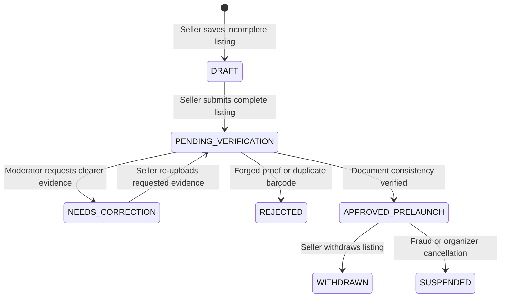

# [DRAFT — NOT APPROVED] TIKUM INTERNAL LISTING MODERATION SOP

**Document ID:** SOP-OPS-001  
**Version:** 1.0.0-DRAFT  
**Date:** 2026-10-28  
**Status:** `DRAFT — NOT OFFICIALLY APPROVED`  
**Classification:** Internal Confidential / Operational Standard Operating Procedure  
**Operating Mode:** `PRELAUNCH_LISTING_ONLY`  

> [!WARNING]  
> **LEGAL & OPERATIONAL BOUNDARY NOTICE:**  
> This Standard Operating Procedure is a draft proposal for internal testing and preparation only. It does NOT authorize public listing publication, external seller onboarding, ticketing commerce, payment collection, or payout disbursement. No individual has been formally appointed to operational roles. All role designations herein are candidates requiring explicit written approval from the business owner.

---

## A. PURPOSE AND OPERATING BOUNDARIES

### 1. Scope & Objective
This SOP governs the intake, verification, correction, approval, and privacy protection of secondary ticket listings during the TIKUM pre-launch phase. The objective is to build a high-integrity, fraud-resistant ticket catalog for upcoming Indonesian entertainment events (e.g., BIGBANG 2027 World Tour at Jakarta International Stadium) without exposing sellers or buyers to financial or legal harm.

### 2. Strict Operating Boundaries
1. **Pre-Launch Mode Non-Purchasability:**  
   The platform operates in `PRELAUNCH_LISTING_ONLY`. Approved listings are given the status `APPROVED_PRELAUNCH` with the hard server-side invariant `is_purchasable: false`. Any customer checkout, order creation, or payment initiation MUST fail-closed with `HTTP 403 [MARKETPLACE_PRELAUNCH_ONLY]`.
2. **Preliminary Review Disclaimer:**  
   Administrative approval in pre-launch mode constitutes only a preliminary consistency and evidence plausibility check. It does **not** guarantee ticket authenticity, promoter transferability, seat legitimacy, or barcode validity at venue gates.
3. **No False Promoter or Venue Representation:**  
   TIKUM does not hold an official partnership with event promoters (e.g., Expo Indo Jaya, YG Entertainment, Live Nation) or venue management (e.g., JIExpo Kemayoran, PT JAKPRO / JIS). Staff and moderators are strictly prohibited from representing TIKUM as an official ticketing partner or claiming venue PIC entrance guarantees without written authorization.
4. **Zero Financial Mutation:**  
   Escrow funds, payments, bank transfers, and automated seller payouts are disabled.

---

## B. ROLES AND RESPONSIBILITIES

All operational roles are designated as `NOT OFFICIALLY ASSIGNED` until formally nominated and signed off by the Business Owner.

| Role Title | Operational Status | Minimum Permission Required | Actions Requiring Escalation | Separation of Duties Invariant |
| :--- | :--- | :--- | :--- | :--- |
| **Primary Moderator** | `CANDIDATE — NOT OFFICIALLY ASSIGNED` | `TRUST_OFFICER` (Read listing queues, inspect evidence, request correction, approve prelaunch, reject) | Duplicate barcodes across sellers, forged invoices, manipulated PDFs, high-value bulk listings (> Rp 10.000.000) | Cannot approve own listings (`CANNOT_APPROVE_OWN_LISTING`); cannot modify tax/fee policies or financial ledgers |
| **Backup Moderator** | `CANDIDATE — NOT OFFICIALLY ASSIGNED` | `TRUST_OFFICER` (Identical queue review permissions activated during primary absence or high volume) | Unresolved dispute escalation, conflicting order IDs, suspect organizer notices | Cannot approve own listings; peer review required for high-risk rejections |
| **Privacy & Evidence Custodian** | `CANDIDATE — NOT OFFICIALLY ASSIGNED` | `SECURITY_ADMIN` (Audit access to evidence bundles, verify redaction, execute retention purge) | Data breach alerts, unredacted PII exposure, subpoena/law enforcement requests, unauthorized document access | Cannot moderate listings; cannot participate in ticket inventory or pricing |
| **Platform Administrator** | `SYSTEM / INFRASTRUCTURE OWNER` | `ADMIN` / `SUPER_ADMIN` (Manage server configuration, review immutable audit trails, rotate keys) | Any change to `MARKETPLACE_MODE`, database schema migrations, environment variable updates | Cannot execute financial payouts without secondary Finance sign-off |
| **Business Owner / Approver** | `EXECUTIVE / BUSINESS OWNER` | Authoritative Sign-off (Repository Owner, Commercial Decision Maker) | Live launch go/no-go, payment provider contracting, promoter partnerships | Sole authority to transition from draft to approved status |

---

## C. LISTING MODERATION WORKFLOW

### 1. Canonical State Lifecycle

### 2. Workflow Decision Criteria

#### Phase 1: Ingestion & Duplicate Check (`PENDING_VERIFICATION`)
- Seller inputs: `eventId`, `seatInfo` (section, row, seat), `faceValue`, `price`, `rawBarcode` (optional during pre-launch), and `evidenceBundleId`.
- **System Automation Gate:**  
  System computes `SHA-256(rawBarcode)`. If the barcode hash already exists for the same `eventId` in non-cancelled tickets, the listing is automatically rejected with `DUPLICATE_TICKET_BARCODE`.
- **Pilot Price Cap Check:**  
  `faceValue` must be $\ge$ Rp 500.000. Markup must not exceed 30% of face value (`MAX_MARKUP_PCT: 30`).

#### Phase 2: Evidence Review
The reviewing Moderator inspects the uploaded booking invoice or ticket proof via the authenticated Admin Control Center:
- Does the buyer name match the registered seller profile name?
- Does the booking order ID follow official ticketing partner format (e.g., Tiket.com, Loket, TipTip, BBO)?
- Are font alignments, resolution, date stamps, and metadata free from obvious digital tampering or image splicing?
- Are section, seat category, and quantity consistent with official event seat layouts?

#### Phase 3: Moderation Outcomes
1. **Decision: Request Correction (`NEEDS_CORRECTION`)**
   - **Trigger:** Blurred screenshot, cropped Order ID, unreadable confirmation email, missing section details.
   - **Procedure:** Moderator selects `action: 'REQUEST_CORRECTION'` and supplies specific feedback (e.g., *"Invoice bukti pembayaran buram. Mohon unggah ulang tangkapan layar yang jelas menampilkan Order ID dan Nama Pemesan"*).
   - **Audit Record:** Generates `LISTING_REQUESTED_CORRECTION` log.
2. **Decision: Rejection (`REJECTED`)**
   - **Trigger:** Blatantly forged invoices, fake barcodes, mismatch with real seating charts, tickets for past/cancelled events, or bad-faith submissions.
   - **Procedure:** Moderator selects `action: 'REJECT'` and enters mandatory `rejection_reason`. Ticket status transitions to `REJECTED`.
   - **Audit Record:** Generates `LISTING_REJECTED` log with reason.
3. **Decision: Pre-Launch Approval (`APPROVED_PRELAUNCH`)**
   - **Trigger:** Evidence is clear, plausible, consistent, and within valid pricing bounds.
   - **Procedure:** Moderator selects `action: 'APPROVE'`.
   - **System Enforcement:** Under `PRELAUNCH_LISTING_ONLY`, the system assigns `status: 'APPROVED_PRELAUNCH'`, `is_prelaunch: true`, and `is_purchasable: false`. The listing appears in the public discovery feed with the banner *"Belum Tersedia"* and checkout buttons disabled.

---

## D. EVIDENCE AND PRIVACY HANDLING

In compliance with **Indonesia UU Pelindungan Data Pribadi (UU PDP No. 27/2022)**:

### 1. Data Minimization
- Calon penjual **tidak diwajibkan** mengunggah KTP/NIK atau nomor rekening bank pada tahap pendaftaran awal listing pre-launch.
- Dokumen yang diterima terbatas pada:
  - Bukti invoice atau email konfirmasi pembelian resmi.
  - Tangkapan layar alokasi tiket/kategori kursi dengan barcode/QR disembunyikan atau di-hash.

### 2. Secure Storage & Encryption
- Bukti file disimpan pada direktori terisolasi (`uploadsDir`) dan dienkripsi saat istirahat (*encryption-at-rest*) menggunakan **AES-256-GCM** melalui `EvidenceStorageService.encryptAndStore`.
- Akses ke file fisik memerlukan HMAC-SHA256 signed URL dengan masa kedaluwarsa maksimal **15 menit** (`SIGNED_URL_TTL_MS: 900000`).

### 3. Public API Redaction Invariant
- Representasi data tiket pada API publik (`GET /api/mvp/listings` dan `GET /api/mvp/listings/:id`) **WAJIB** menghapus seluruh data sensitif:
  - `rawBarcode` / `barcode_hash` $\rightarrow$ `undefined`
  - `nik` / `ktp_photo` $\rightarrow$ `undefined`
  - `bank_account` / `payout_info` $\rightarrow$ `undefined`
  - `evidence_bundle_id` / internal file paths $\rightarrow$ `undefined`

### 4. Retention & Purging Policy
- **Masa Retensi:** Sesuai konfigurasi `RETENTION_CONFIG`, data transaksi yang telah selesai disimpan maksimal 90 hari pasca-event, kecuali terdapat sengketa aktif (*legal hold*).
- **Penghapusan Pre-Launch:** Fixture data pengujian sintetis dihancurkan seketika saat reset in-memory database. Jika calon penjual membatalkan listing (`WITHDRAWN`), file bukti harus dianonimkan atau dihapus dalam 7x24 jam.
- *(Catatan: Kebijakan retensi final tetap menunggu persetujuan legal/konsultan kepatuhan data pribadi).*

---

## E. ESCALATION AND INCIDENT HANDLING

| Incident Type | Detection Indicator | Containment Procedure | Escalation Owner |
| :--- | :--- | :--- | :--- |
| **Manipulated / Forged Evidence** | Inconsistent font, artifacting around order date/price | Listing immediately marked `REJECTED`, seller account flagged for review | Primary Moderator $\rightarrow$ Privacy Custodian |
| **Duplicate Barcode Collision** | `DUPLICATE_TICKET_BARCODE` error on submission | Suspend second listing, audit initial listing evidence for genuine ownership | Primary Moderator $\rightarrow$ Platform Admin |
| **Suspected PII / Barcode Leak** | Raw barcode or invoice visible on public endpoint or HTML source | Immediate rollback of API layer, rotate signed secret, trigger security notification | Privacy & Evidence Custodian |
| **Unauthorized Moderation Attempt** | 403 `CANNOT_APPROVE_OWN_LISTING` or 401 on `/api/admin/*` | Session revoked, IP blocked, incident logged in `audit_logs` | Platform Administrator |
| **Pressure to Enable Transactions** | Seller/buyer asks to transact via manual transfer | State clearly that transactions are disabled by platform policy; never share personal bank accounts | Platform Administrator |

---

## F. APPROVAL & GOVERNANCE CHECKLIST

This document is **NOT ACTIVE** and holds no operational validity until all the following formal approvals are signed:

- [ ] **Business Owner / Repository Owner Sign-Off:**  
  *Name:* ___________________________ | *Signature:* ____________ | *Date:* ____________
- [ ] **Appointed Primary Moderator Sign-Off:**  
  *Name:* ___________________________ | *Signature:* ____________ | *Date:* ____________
- [ ] **Appointed Backup Moderator Sign-Off:**  
  *Name:* ___________________________ | *Signature:* ____________ | *Date:* ____________
- [ ] **Appointed Privacy & Evidence Custodian Sign-Off:**  
  *Name:* ___________________________ | *Signature:* ____________ | *Date:* ____________

**Document Status:** `DRAFT — AWAITING EXPLICIT APPROVAL`
