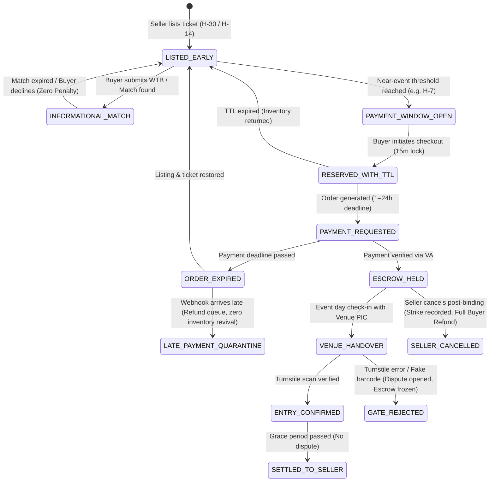

# TIKUM — Near-Event Transaction Model, Seller Commitment & Operational Capacity Audit

**Document Version:** 1.0.0  
**Date:** 2026-10-28  
**Repository:** `agunsux/ARGUS`  
**Current HEAD:** `623e352`  
**Branch:** `dryrun/internal-listing-pilot`  
**Operating Mode:** `PRELAUNCH_LISTING_ONLY` (Fail-Closed)  
**Parent Entity:** `PT SHINERVA PRAJNA TEJAS`  
**Focus:** Audit of near-event transactions (H-7), Want-To-Buy (WTB) matching, deposit policy, seller commitment/cancellation, markup caps, Venue PIC operations, and capacity metrics.

---

## 1. Executive Implementation Matrix

| Requirement Domain | Current Repository Status | Relevant Files | Audit Verdict & Gap Analysis |
|---|---|---|---|
| **1. Early Listing & WTB Demand** | **PARTIAL / CONFLICTING** | `ListingWindowPolicy.js` `DemandCaptureService.js` `ReservationService.js` | **Conflict:** Current `ListingWindowPolicy.js` blocks listing creation before H-7 (unless in prelaunch collection mode). It should allow listings and WTB requests early while restricting *binding payment checkout* to near-event. |
| **2. Non-Binding Pre-Window Match** | **IMPLEMENTED** | `ListingWindowPolicy.js` `MarketplaceListingService.js` | Added `evaluateInformationalMatch()`: matches prior to near-event payment window are strictly non-binding with zero deposit and clear expiration. |
| **3. Zero Deposit (DP) in MVP** | **IMPLEMENTED** | `ReservationService.js` `escrowService.js` | No reservation deposit or seller bond is requested or collected. Reservations use atomic mutex with TTL. |
| **4. Configurable Payment Window (H-7 Proposal)** | **IMPLEMENTED** | `ListingWindowPolicy.js` | H-7 proposal implemented as a configurable parameter (`customWindowDays` or `event.payment_window_days`), accommodating event-specific wristband pickup and transfer cutoffs. |
| **5. Configurable Payment Deadline (1–24h)** | **IMPLEMENTED** | `escrowService.js` `MarketplaceOrderService.js` | `paymentDeadlineHours` defaults to 2 hours, fully configurable within the 1–24h window. |
| **6. Inventory Release on Expiry** | **IMPLEMENTED** | `MarketplaceOrderService.js` `escrowService.js` | Expired reservations and unpaid orders atomically revert listing to `ACTIVE` and ticket to `LISTED`. |
| **7. Late Payment Quarantine** | **IMPLEMENTED** | `PaymentService.js` | Payments received after order expiry are quarantined into `LATE_PAYMENT_PENDING_REVIEW` with immediate refund routing. No inventory resurrection. |
| **8. Anti-Screenshot Ownership Verification** | **IMPLEMENTED** | `TicketTrustService.js` `EvidenceService.js` | Verification strictly rejects screenshot uploads alone (`AUTHORITATIVE_EVIDENCE_REQUIRED`: requires booking confirmation, primary invoice, or gate attestation). |
| **9. Post-Binding Seller Cancellation Tracking** | **IMPLEMENTED** | `sellerCommitmentService.js` `MarketplaceOrderService.js` | Dedicated `sellerCancelOrder()` records cancellation reason, timing, evidence, buyer impact level, and triggers full buyer refund. |
| **10. Configurable Seller Strike System** | **IMPLEMENTED** | `sellerCommitmentService.js` `SellerTrustService.js` | Added strike progression without assuming a rigid 3-strike ban: Warning (1), Probation (2), Suspension Review (3), with weighted penalty for near-event cancellations ($\le 24$h carries double weight). |
| **11. Anti-Scalping & Configurable Markup Cap** | **IMPLEMENTED** | `pricingConfig.js` `TransactionQuoteService.js` | Server-side calculation is 100% enforced (client overrides rejected). Price validation checks against configurable markup cap (`configuredMarkupPct`, e.g. 20% vs 30%). Missing face value routes to manual review. |
| **12. Zero Seller Bonds / Fund Holds** | **IMPLEMENTED** | `escrowService.js` `FinancialLedger.js` | No seller bonds or upfront fund holds are implemented or collected. |
| **13. Venue PIC Workflow & Handover Evidence** | **IMPLEMENTED** | `EventPicService.js` `TrustPolicyEngine.js` | Multi-stage lifecycle (`ASSIGNED` $\rightarrow$ `ENTRY_CONFIRMED`), gate checks, anti-conflict rules, and exception handling (`GATE_REJECTION`, `INVALID`, `TICKET_PROBLEM`, `DUPLICATE_ENTRY`). |
| **14. Operational Capacity Metrics** | **IMPLEMENTED** | `VenueOperationsCapacityService.js` `TransactionControlCenterService.js` | Dedicated service evaluating the 6 mandatory empirical capacity metrics without inventing artificial throughput SLAs. |

---

## 2. Business Decisions Requiring Explicit Business Owner Approval

The following items are strategic business policy decisions and **must not be hardcoded or assumed** without explicit authorization:

1. **Maximum Markup Cap Percentage (20% vs 25% vs 30%):**
   - *Proposal:* 20%–30% above verified primary face value.
   - *Current Code:* Configurable via `configuredMarkupPct` or `event.max_markup_pct`, defaulting to 30%.
   - *Required Decision:* Business owner confirmation of default cap (e.g. 20% conservative vs 30% standard) and whether caps vary by event category (e.g. international stadium concerts vs local club gigs).
2. **Standard Payment Window Starting Point (H-7 vs Event Specific):**
   - *Proposal:* H-7 as the starting benchmark.
   - *Required Decision:* Rules for events with physical wristband exchange (often H-3 or H-2) vs digital e-ticket barcode distribution (often H-1 or 24 hours before showtime).
3. **Seller Strike Policy & Penalty Structure:**
   - *Proposal:* Configurable strike escalation (Warning $\rightarrow$ Probation $\rightarrow$ Suspension).
   - *Required Decision:* Thresholds for suspension (e.g. 2 strikes near event day vs 3 strikes standard) and appeal/rehabilitation mechanism. No rigid 3-strike rule without approval.
4. **Deposit / Down Payment (DP) Model in Future Phases:**
   - *Current MVP:* Strict zero-deposit policy. Matches and reservations are non-binding/TTL locks.
   - *Future Consideration:* Whether a buyer reservation deposit or seller listing pledge will be introduced once merchant licensing and payment provider authorization permit.

---

## 3. Near-Event Payment Window & Inventory Lifecycle

---

## 4. Anti-Scalping & Pricing Policy Rules

1. **Authoritative Calculation:** All pricing, buyer fees, platform revenues, and tax liabilities are calculated exclusively by server-side engines (`calculatePricing()` and `TransactionQuoteService.js`). Client-supplied amounts are ignored.
2. **Markup Cap Validation:**
   $$\text{Max Allowed Price} = \lfloor \text{Verified Face Value} \times (1 + \text{Configured Markup \%} / 100) \rfloor$$
3. **Face Value Verification Sources:**
   - Primary promoter official price lists (e.g. APMI / Loket / Tiket.com official rates).
   - Validated primary purchase invoices attached to canonical ticket records.
   - If face value is unverified: Asking price markup cannot be verified automatically; listing is flagged with `needsManualReview: true` and routed to the Trust & Safety moderation queue.
4. **Permissible Fee Handling:**
   - Platform service fee: Default 6% (clamped Rp 35.000 – Rp 300.000).
   - Taxes: PPN 11% calculated transparently.
   - Unofficial promoter "jastip" markups are strictly excluded from the baseline face value.

---

## 5. Seller Commitment & Cancellation Policy

1. **Pre-Binding Phase (Listing / Informational Match):**
   - Seller may withdraw or adjust listings freely without penalty prior to order creation.
2. **Post-Binding Phase (Order Created & Escrow Funded):**
   - A binding transaction exists. Seller is obligated to fulfill the ticket handover.
   - If seller cancels or fails to deliver:
     - Transaction is marked `SELLER_CANCELLED`.
     - 100% of buyer funds are routed to immediate refund.
     - Cancellation event is logged with: seller ID, order ID, timing relative to event date (hours remaining), declared reason, and evidence.
     - **Buyer Impact Scoring:**
       - $\text{Hours to Event} \le 24$: **CRITICAL IMPACT** (Severely jeopardizes buyer attendance).
       - $24 < \text{Hours to Event} \le 72$: **HIGH IMPACT**.
       - $\text{Hours to Event} > 72$: **MEDIUM IMPACT**.
     - **Configurable Strike Increment:** Strike added to seller profile. Cumulative strikes trigger probation or review.
3. **Prohibition of Unauthorized Bonds:**
   - TIKUM does not hold monetary security deposits or seller penalty bonds until formal payment provider approval and regulatory clearance are obtained.

---

## 6. Venue PIC Operations & Fulfillment Exceptions

1. **Venue PIC Assignment:** Linked by `EVENT -> VENUE -> DATE -> PIC`. PICs must be registered with active operational status.
2. **Handover Evidence Requirements:**
   - Physical ticket / wristband handover: Signed digital confirmation or photo verification of physical pass exchange.
   - Digital e-ticket: Official transfer confirmation or turnstile entry attestation.
3. **Fulfillment Exceptions Handled:**
   - `GATE_REJECTION`: Ticket barcode fails at turnstile. Immediate escrow hold; incident logged for investigation.
   - `INVALID`: Counterfeit or altered ticket detected. Escrow frozen; seller flagged for critical fraud review.
   - `DUPLICATE_ENTRY`: Ticket already scanned by a third party. Escrow held; dispute opened.
   - `NO_SHOW_SELLER`: Seller fails to appear at designated venue meetup point. Immediate buyer refund queue.
   - `NO_SHOW_BUYER`: Buyer fails to attend after seller confirms attendance with Venue PIC. Escrow held for ops manual review.
   - `PIC_UNAVAILABLE`: Backup PIC routed or supervisor attestation activated via `TrustPolicyEngine`.

---

## 7. Operational Capacity Metrics (H-7 through Event Day)

In accordance with Section 8 of the epic, TIKUM establishes the **6 mandatory operational metrics** to monitor field operations without fabricating arbitrary throughput promises:

| Metric | Measurement Unit | Purpose | Source Service |
|---|---|---|---|
| **1. Transactions per Event** | Count per canonical event | Event density & overall exposure | `TransactionControlCenterService` |
| **2. Expected Handovers per Hour** | Rate ($\text{orders} / \text{hr}$) across time buckets | Peak congestion detection | `VenueOperationsCapacityService` |
| **3. PIC Availability & Assignments** | Active PICs vs Assigned Orders | Workload balance per operational cell | `EventPicService` |
| **4. Pending Verifications** | Count of unverified tickets in window | Moderation backlog tracking | `TicketTrustService` |
| **5. Failed Handovers & Disputes** | Count & percentage of total volume | Field friction & quality gate metric | `IncidentService` / `DisputeService` |
| **6. Escalation Backlog & Response Time** | Average minutes to first ops triage | SLA measurement during pilot | `TransactionControlCenterService` |

> [!IMPORTANT]
> **Empirical Calibration Principle:** TIKUM does not claim an artificial "safe orders per PIC" threshold prior to live operations. The initial pilot events will serve as the empirical baseline to measure real handover duration, venue cellular connectivity constraints, and turnstile queuing delays.
